# Sidekick Mechanic

An iPhone app you text like a friend who knows trucks. Describe what the truck is doing, and it answers from the factory repair manual, shows the exact page it used, and can outline the part on an engine-bay photo.

It's built for one truck: a 1990 Land Cruiser LJ78 with a 2JZ-GE swap and a Lexus donor ECU. The truck hasn't arrived yet, so anything the app doesn't know about it stays `TBD` instead of getting guessed.

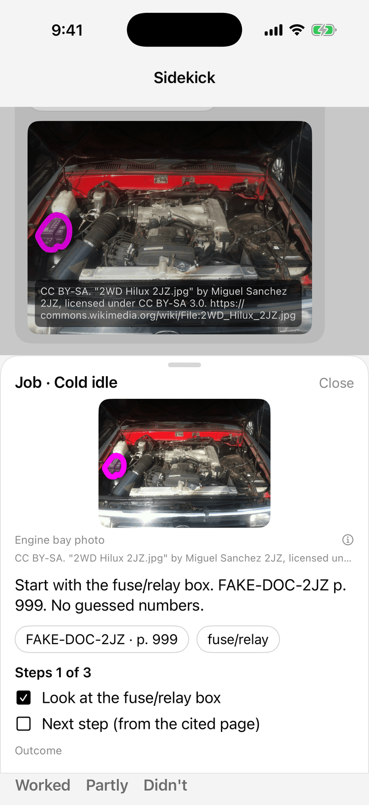

## What works today

Everything in this section is in the code on `main`. Anything not built yet lives in the [Roadmap](#roadmap-not-built-yet).

### "The manual is a 1,959-page PDF"

Search is useless when you don't know the factory's name for the part, so the user just describes the problem. The reply comes from the manual with a chip like `2jz-ge-rm · p. 967`, and tapping it opens that page on the phone. The quoted line has to be an exact piece of the page's text, or the citation is dropped.

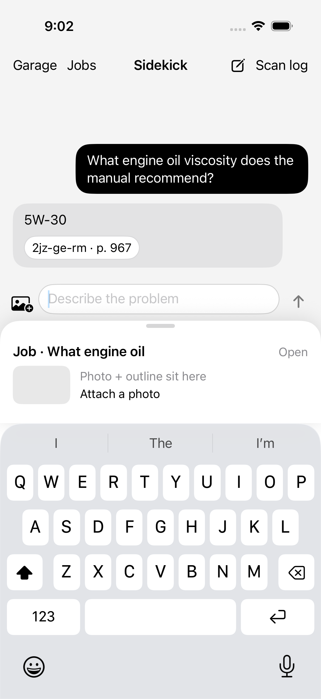

### "A forum gave me a torque spec for a different engine"

A wrong number breaks parts. So after the model answers, plain code checks every number with a unit (a torque, a temperature) and every pin or connector name. If it isn't in the manual text the answer cited, it's removed, and the reply says "Not found in the cited manual text" and names what it blocked.

*TODO: no screenshot yet of the number check blocking a value ("Not found in the cited manual text" naming what it blocked).*

### "Which plug is this?"

Connectors look alike until you unplug the wrong one. The user snaps a photo of the plug, and the backend sends it with the manual page to a vision model (one that can read images). The model only describes shape, pin count, color, and label. Code makes the call, and a match needs something it can point to in the page text. If it can't tell, it says "unsure". The photo isn't saved.

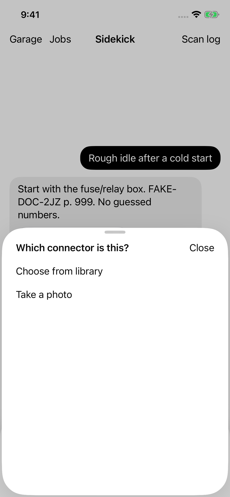

*TODO: no screenshot yet of a plug-check result (a match, or "unsure"). The sheet above is only the photo picker.*

### "This page was written for a dealer tech"

On any cited page, **Ask about this page** offers three starters: "Explain this page simply", "What tools do I need?", and "Which connector is this?". The server uses that one page's text as its only evidence. **Go deeper** adds a short plain-English note: how it works, what to test, how, and with what tools.

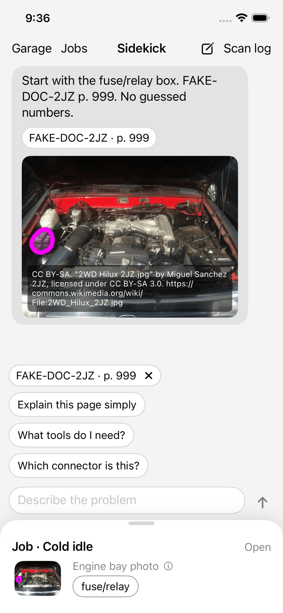 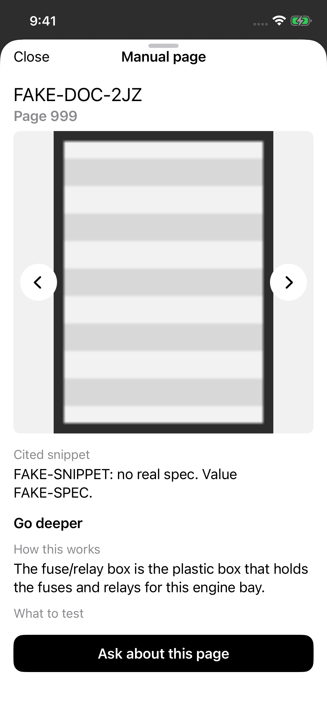

### "I already wrote that down"

The Garage holds truck facts, parts, photos, and to-dos. Facts, parts, and open to-dos ride along with each question, so a reply can say "Garage notes show 0W-20, which does not match." Garage notes are never passed off as a manual citation.

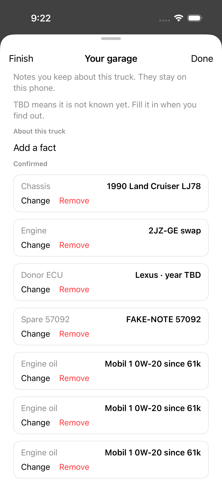 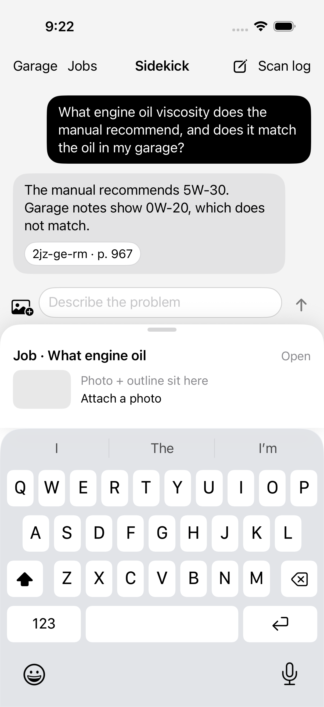

### "The manual doesn't cover this"

When the search finds nothing, the reply says so first: "Not in your manual. Here's what usually causes this." Then come cheap checks, cheapest first, under a safety line, and they still go through the number check. A chassis wiring question gets told that wiring manual isn't loaded yet, instead of a guessed wire color.

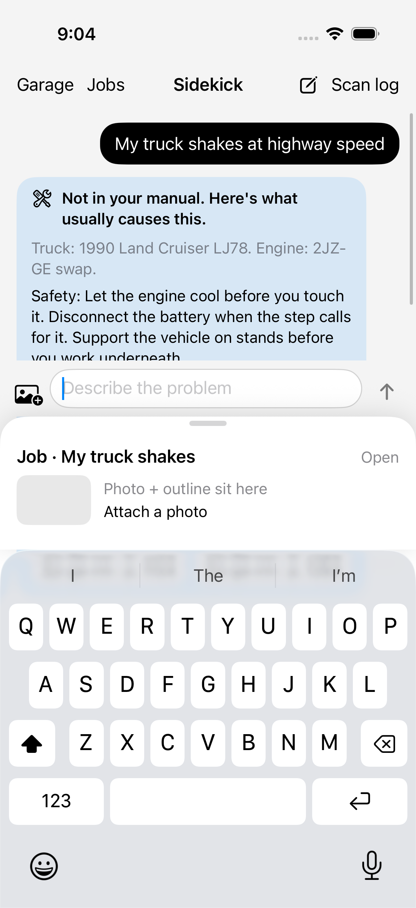

### "Where is that part in this mess of hoses?"

The app draws a clean outline around the part on an engine-bay photo. To be exact about what this is: 2D outlines on still photos, traced by hand ahead of time on four public demo photos. Nothing is detected live, and it isn't AR. The part comes from the user's question but only from that photo's list of traced parts; otherwise the app says "This part is not mapped yet."

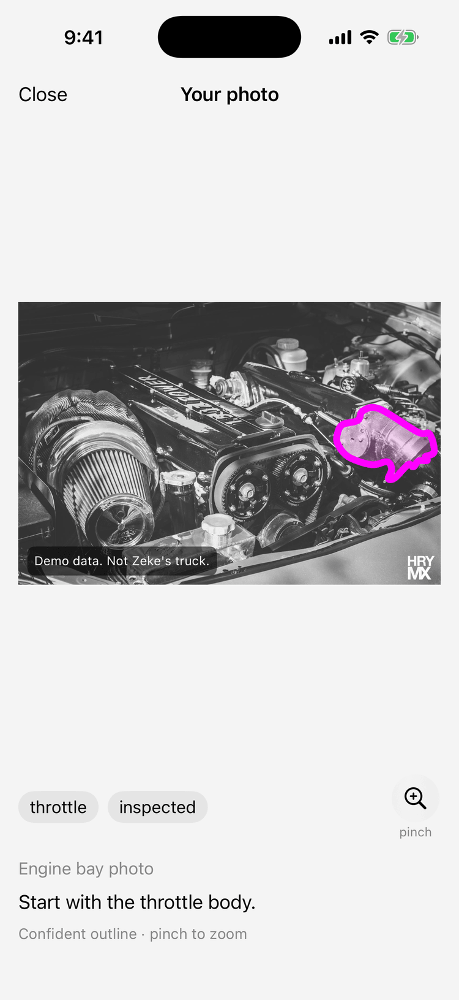 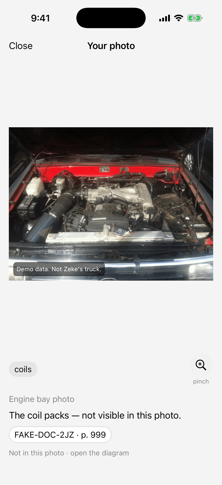

### "The repair takes all week"

Each problem gets its own saved chat, titled like "Cold idle", that the user can mark Worked, Partly, or Didn't. It's saved on the phone.

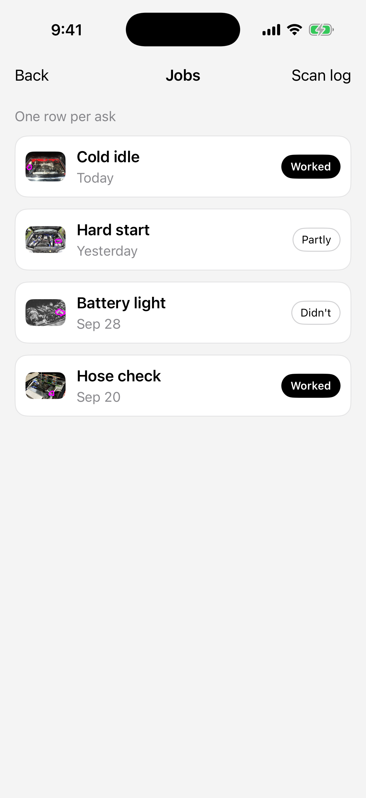

## How it works

A SwiftUI iPhone app talks to a Python FastAPI backend. Manual search is SQLite full-text search (FTS5): it matches the question's words against each page's words and ranks the pages. That's keyword search. There are no embeddings or vector search in this repo. The answer model is any OpenAI-compatible endpoint (default `gpt-4o-mini`). With no API key, a fake offline client stands in.

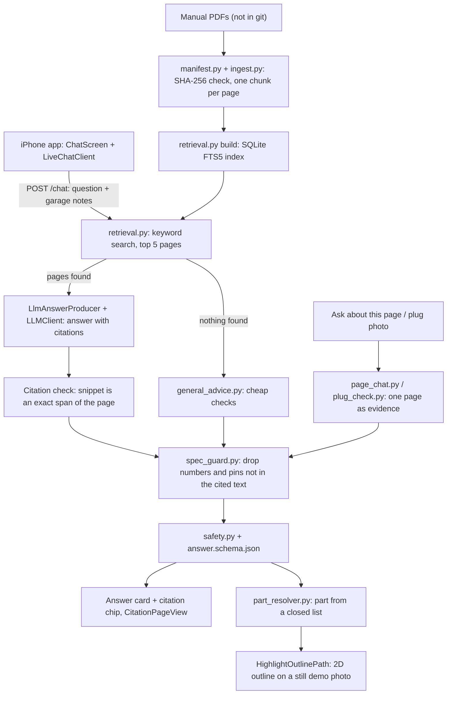

There's an eval harness (`make eval`) with a 50-question golden set. The only committed run is a smoke test against the fake model, so there are no real accuracy numbers yet.

## Roadmap (not built yet)

None of this exists in the code today. See [ROADMAP.md](ROADMAP.md).

- **Live camera AR** with readings pinned to the part. No ARKit, RealityKit, Core ML, or Vision code exists.
- **On-device part detection** with a YOLO11n model on Core ML. No model is trained, and `ml/` is empty.
- **OBD-II live engine data** over a Bluetooth ELM327 reader. Today's Readings screen plays a simulated scenario.
- **Embeddings or vector search.** What shipped is keyword search.
- **Outlines on the user's own bay photos** (#109), an **"Is this it?"** check for unsure outlines (#87, built but switched off), **pinch on the highlight photo** (#106), and **interactive job steps** (#129).
- **A garage projector** that lights up a part. A moonshot.

## Quickstart

**You need:** a Mac with Xcode (iOS 17 target, Swift 6), [XcodeGen](https://github.com/yonaskolb/XcodeGen), Python 3.11+, and `tesseract-ocr` plus `poppler-utils`.

```bash
git clone https://github.com/zeketx/sidekick-mechanic.git
cd sidekick-mechanic/backend
pip install -r requirements.txt
uvicorn app:app --reload --host 127.0.0.1 --port 8000
```

That runs with no key and no manuals: a fake model answers, and with no index every question gets the "Not in your manual" reply. For a real model:

```bash
cp .env.example .env   # set SIDEKICK_LLM_API_KEY; SIDEKICK_VISION_* for the plug check
set -a && source .env && set +a
```

To search real manuals, put your own PDFs in `manuals/` (they're copyrighted, so they're not in the repo) and build the index:

```bash
python3 manifest.py && python3 ingest.py   # checks each PDF's SHA-256 against docs/MANUALS.md
python3 retrieval.py build                 # SQLite FTS5 index in backend/.ingest/
```

Then the app. It calls `http://localhost:8000`, which works in the Simulator. To change it, edit the `SIDEKICK_BACKEND_URL` build setting in `app/project.yml`.

```bash
cd ../app
xcodegen
open SidekickMechanic.xcodeproj   # scheme: SidekickMechanic, pick an iPhone simulator, Run
```

Tests: `python -m pytest` in `backend/`, `swift test` in `app/SidekickCore` (also runs on Linux), and `make eval` from the repo root.

## Credits

Demo mode uses four public engine-bay photos, resized, with this project's own outlines drawn on top.

- "2WD Hilux 2JZ.jpg" by [Miguel Sanchez 2JZ](https://commons.wikimedia.org/wiki/File:2WD_Hilux_2JZ.jpg), [CC BY-SA 3.0](https://creativecommons.org/licenses/by-sa/3.0), via Wikimedia Commons. Screenshots here showing this photo with an outline are adaptations, shared under CC BY-SA 3.0.
- "2JZ-GE Engine" by [HRYMX](https://www.flickr.com/photos/henrymaxm/25308847029/), [CC BY 2.0](https://creativecommons.org/licenses/by/2.0/).
- "2JZ Power - aww yeah" by [Rob Marson](https://www.flickr.com/photos/35003991@N03/6763892857), [CC BY 2.0](https://creativecommons.org/licenses/by/2.0/).
- "Toyota Supra (N5 ABH) - engine - 7 June 2026.jpg" by [Aethonatic](https://commons.wikimedia.org/wiki/File:Toyota_Supra_(N5_ABH)_-_engine_-_7_June_2026.jpg), [CC0](http://creativecommons.org/publicdomain/zero/1.0/deed.en).

Details: [backend/data/demo/ATTRIBUTION.md](backend/data/demo/ATTRIBUTION.md).

Licensed under the [MIT License](LICENSE). Copyright 2026 Ezekiel Mauricio.
