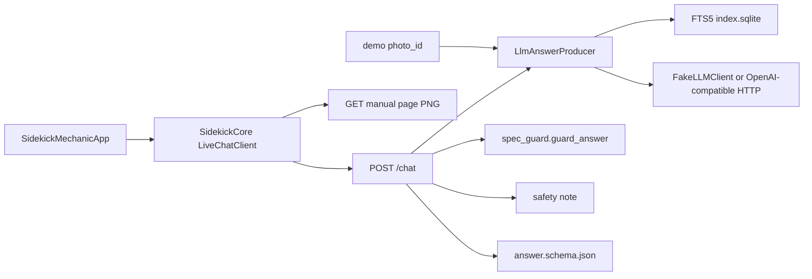

# Architecture audit

Read-only pass over the tree on 2026-10-10. No app or backend code was changed. Line numbers are from that tree.

## Verdict

This is not a grenade in the structural sense. `SidekickCore` owns the shared types, the SwiftUI app is a shell, and the backend is one FastAPI process with a real retrieval path and a spec guard on `POST /chat`. The dangerous part is narrower, and it is critical. The spec guard, which issue #21 says must refuse any torque that is not in the cited text, misreads the torque spelling Toyota manuals use, and a missing index returns the model's uncited prose as a normal answer. The one data-loss path is the garage file: a decode failure loads the seed, and the next edit writes that seed over `garage.json`. The eval process exits 0 when its quality numbers are 0. The highlight the docs describe is a scripted demo, and the spike that was supposed to choose a pipeline already failed its own bar on a branch that is not `main`. Fix the guard, the missing-index path, and the garage overwrite before a live key reads the repair manual or the garage schema grows a field. The rest is a one-person app that has not shipped, and it can stay that way until the truck or a second user shows up.

## What actually runs

Launch always builds `LiveChatClient` against `AppConfig.backendURL` at `app/SidekickMechanic/SidekickMechanicApp.swift:25`. `ChatClientKind` still defaults to mock at `app/SidekickCore/Sources/SidekickCore/ChatClient.swift:20-28`, and the app entry never calls it.

`POST /chat` at `backend/app.py:127-146` runs the producer, then `guard_answer`, then the safety note, then JSON Schema validation. There is no auth dependency on that route. `default_producer` at `backend/producer.py:311-312` builds the producer with an index retriever and no bay map. A demo `photo_id` is the only path that attaches polygons, and those polygons come from `backend/data/demo/demo_bay_photos.json`.

There is no Dockerfile, no `railway.toml`, and no Sidekick service in the owner's Railway account as checked on 2026-10-10. Docs that call the OpenRouter key a Railway secret are ahead of the deploy.

## Findings

| Severity | Subsystem | Finding | Evidence | Fix |
| --- | --- | --- | --- | --- |
| critical | spec guard | `13 ft·lbf` and `13 ft-lbf` become the claim `13 ft`, the same claim as `13 feet`. `13 ft·lb` becomes `13 ftlbf`. A length and a foot-pound torque can satisfy each other. | `backend/spec_guard.py:33-36` and `:55-57`. Confirmed by calling `_extract`. | S |
| critical | spec guard | `180 kgf·cm` produces no claim, so a torque written only that way is never blocked. `18 N·m` is blocked unless a chunk has it. `pin NE`, `terminal NE`, and `B-R` produce no claim. | Same extractor run. Unit table at `backend/spec_guard.py:30-32` has `kgf·m` and `kgf/cm2`, not `kgf·cm`. | S |
| critical | retrieval | A missing `backend/.ingest/index.sqlite` skips retrieval and returns model prose with an empty citation list. The directory is gitignored. Claims the guard does not extract then ship. | `backend/producer.py:184-185` and `:222-231`. | S |
| high | spec guard | A claim is allowed when it appears in any of the top retrieved pages, not on the cited page. Retrieval runs twice, both times on the last user message only, so a follow-up such as "And the gap?" is searched on its own. Issue #21 says a cited chunk. | `backend/spec_guard.py:165-170`. `backend/producer.py:179`, `:209-220`, and `:370-374`. | M |
| high | persistence | A `garage.json` that fails to decode loads the seed and leaves writes on. The next add, edit, or to-do toggle replaces the file with that seed. Photo files stay on disk and become orphans. Adding a non-optional Codable field is enough to cause the decode failure. | `GarageLibrary.swift:291-300` throws. `GarageModel.init` at lines 412-418 catches and seeds. `commit` at lines 544-553 then `save` at lines 304-309. | S |
| high | citations | A snippet can be a rearrangement of page tokens and is shown as the quote. | `backend/retrieval.py:238-249`. | S |
| high | eval | The process exits 0 unless a highlight names an unmapped part. Citation accuracy, refusal correctness, and correct-part rate are not gates. | `backend/eval/__main__.py:79-84`. | M |
| high | CI | The eval job runs only on pull requests, and only on the 4-row fake sample. `golden.jsonl` is 52 questions, 13 marked `ci`. `make eval` selects that file when it exists. | `.github/workflows/ci.yml:72` and `:91`. `backend/eval/golden.py:44-50`. `README.md:15` still says the command scores the fake sample. | S |
| high | highlight | Default chat attaches no highlight. Demo highlights are a string match onto frozen polygons. Issue #85, comment on 2026-10-03, says candidate A had 7 of 13 confident outlines wrong and confident outlines on untraced photos are off for v1. That write-up is not on `main`. | `backend/producer.py:269-271` and `:311-312`. `backend/data/demo/demo_bay_photos.json:2`. Branch `origin/cursor/open-world-part-masks-8e59` is not an ancestor of `main`. | L |
| medium | backend | Provider failure, a bad key, and a timeout are HTTP 200 with `kind` `answer` and the sentence "The mechanic is unavailable right now." The phone treats any 200 as a real answer. | `backend/producer.py:69-73`. `app/SidekickCore/Sources/SidekickCore/LiveChatClient.swift:112-113`. | S |
| medium | backend | The phone gives up at 30 seconds. The server default is three 30-second attempts. | `app/SidekickCore/Sources/SidekickCore/ChatClient.swift:36`. `backend/llm.py:18-19`. | S |
| medium | backend | `pdftoppm` has no timeout. | `backend/manual_pages.py:123-140`. | S |
| medium | app | A non-demo highlight is a photo icon and the words "Bay photo." `BayMap.resolve` is not on that path. | `app/SidekickMechanic/AnswerCardView.swift:33-37` and `:106-121`. | L for a renderer, S for the docs |
| medium | app | A missing `display` is outline on the card and not-found on the job sheet. | `app/SidekickCore/Sources/SidekickCore/ChatViewModel.swift:112`. `app/SidekickCore/Sources/SidekickCore/HighlightViewer.swift:34-35`. | S |
| medium | tests | A test chunk stores `Torque: 18 N·m (180 kgf·cm, 13 ft·lbf)` plus `B02630` and `IG0152` on `2jz-ge-rm` page 985. It is not marked `FAKE-SPEC`. This audit does not treat that string as a vehicle fact. | `backend/tests/test_manual_pages.py:266-274`. | S |
| medium | docs | `docs/design/spec-guard.md:89` says `LlmAnswerProducer` supplies no chunk text, so every spec is refused. `producer.py:209-220` supplies the hit text. | Those two files. | S |
| medium | demo | A located highlight replaces the cited answer with a sentence that calls the stand-in JPEG "this demo photo of a 1990 Toyota Land Cruiser LJ78 with a 2JZ-GE swap." The catalog label on the same module says the photos are not Zeke's truck. Attaching a photo on the job sheet also replaces the answer text with scripted copy. | `backend/demo.py:33` and `:484-493`. `JobSheet.swift:480-487`. | S |
| medium | config | No Sidekick Railway service and no `OPENROUTER` variable name on the account that holds the owner's other projects. The key in docs is not a live secret. | Railway inventory, 2026-10-10. No Dockerfile or `railway.toml` in the tree. | S |
| low | API | `POST /chat`, page PNGs, and go-deeper have no auth. The README binds `127.0.0.1`. The app does not enforce that bind. | `backend/app.py:127`. | M if this is ever reachable off the laptop |
| low | retrieval | An FTS `OperationalError` becomes an empty hit list, then "not in the manual." | `backend/retrieval.py:408-411`. `backend/producer.py:188-189`. | S |
| low | persistence | Chat, confirm taps, and the job sheet are a new UUID every launch. Garage notes are the durable store. | `SidekickMechanicApp.swift:19`. `JobSheet.swift:384`. | M, and it is issue #128 |

## Fix now

Do these before a live `SIDEKICK_LLM_API_KEY` is used against the repair manual, and before the next edit to a garage file the app cannot decode.

1. Teach the spec guard `ft·lbf` and `kgf·cm`, and stop treating `ft·lbf` as feet. Size S.
2. When the index file is missing, return the not-found refusal. Do not call the model. Size S.
3. Require a citation snippet to be a contiguous span of the page. Size S.
4. Check a claim against the pages that survived as citations, not against every hit. Size M.
5. Replace the page-985 test chunk with an obvious `FAKE-SPEC` value. Size S.
6. On a garage decode failure, rename the file aside before any write, or refuse writes until it loads. Size S.
7. Stop reading an exit code of 0 from `python -m eval` as a quality result. Point the README at `golden.jsonl`, and either keep the CI job labeled as a smoke test or fail it when citation accuracy is 0 on a run that was supposed to retrieve. Size S for the label, M for a real gate.
8. Correct `docs/design/spec-guard.md` so it matches `cited_chunk_texts`. Size S.
9. Stop replacing the cited answer when a demo outline matches. Keep the page text, and stop naming the stand-in JPEG as the owner's truck. Size S.

## Fine for a personal app, revisit later

One owner, two ingested manuals, four demo JPEGs, and no public URL.

- No authentication, one sync worker, and a local SQLite file. That breaks when a second person or a second replica shows up. It does not matter on a laptop.
- Embeddings. The design note chose FTS5 for two manuals and one user, and it says to revisit if recall on paraphrase stalls. `docs/design/retrieval-index.md:52-80`. PR #119 retuned lexical ranking and kept that choice.
- The untraced-photo pipeline. Issue #85 already said not to ship confident outlines. Do not start it from this audit.
- Per-job chat and a saved outcome. Issue #128. The shape is in `docs/DATA_SCHEMA.md`.
- A Swift renderer that matches the Python golden images. The card placeholder is honest until that exists.
- A Railway service. Add it when there is a deploy, and put the key there then.
- Aligning the phone timeout with the server retry budget. Annoying, not a wrong torque.

## Keep

- The package split. Logic that Linux can test lives in `SidekickCore`. The app target is SwiftUI. No SwiftData, no Apple import in the package sources that this pass opened.
- `Answer` as a sum type. A refusal cannot carry citations or a highlight. `Answer.swift:20-29` and the decoder at lines 71-76.
- One JSON schema and fixtures decoded on both sides. The Swift names follow the wire keys on purpose. `docs/design/conversation-answer-model.md` records that. Do not add a second wire type.
- The spec guard as a step on `POST /chat`, after generation and before the safety note. The hole is the unit table, not the decision to have the step.
- FTS5 as the Phase 1 store. Stdlib `sqlite3`, one file, page-level chunks, SHA check before ingest. That matches one truck.
- Keys only from the environment. `.env.example` leaves `SIDEKICK_LLM_API_KEY` empty and selects `FakeLLMClient` when it is empty. `backend/llm.py:174-178`. No API key is committed.
- The catalog label that says the polygons are scripted and the photos are not the owner's truck. `backend/data/demo/demo_bay_photos.json:2` and `DEMO_LABEL` at `backend/demo.py:33`. The located-answer sentence does not follow that label. That sentence is in the fix-now list.
- The blocked-manual refusal for chassis wiring when `lj78-wiring` is `blocked`. Keep that fail-closed. The fail-open on a broken manifest, `producer.py` returning false on `ManifestError`, is the small exception in the fix-now list only if you touch that function anyway.

## How this shape got here

The design notes did get written. What did not happen is a review of the code against those notes.

Issue #19 asked for an architect pass and named a vector extension versus a flat file. PR #64, merged 2026-10-01 at 17:00 UTC, compared FTS5 with a JSONL index, deferred sqlite-vec, and closed the issue. The words "one user" are in that design note, not in the issue. The answer contract landed in PR #55 the same day at 16:39 UTC, about twenty minutes earlier, so the wire shape was already merged when that comparison ran.

Issue #21 was written with the rest of the kickoff on 2026-09-30. It is the planned safety control. No issue or commit describes an incident.

PR #60 and PR #64 say "architect pass" inside the same change that added the code. Those pull requests merged in minutes and have no GitHub review. `docs/POTETO_PLAN.md` has required `/interrogate` on the spec guard since the planning commit. No feature PR body contains that word. The repo setting that turns the pstack plugin on landed in PR #125 on 2026-10-10, after the feature commits.

Issue #33 is closed as completed. GitHub lists PR #92 and PR #93 as the pull requests that closed it. Both bodies say "Does not close #33." GitHub's keyword match still sees `close #33` inside that sentence. The acceptance criteria on the issue are unchecked, and the iOS renderer they name is still the photo-icon placeholder.

The highlight decision that failed the 5% bar is on `origin/cursor/open-world-part-masks-8e59` and in the issue #85 comment. `main` still says the pipeline is not chosen, and demo mode on `main` still shows a confirm state the unmerged note said to keep off the screen.
