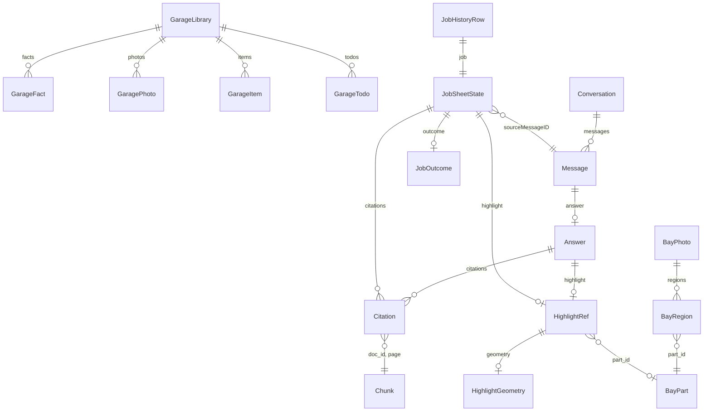
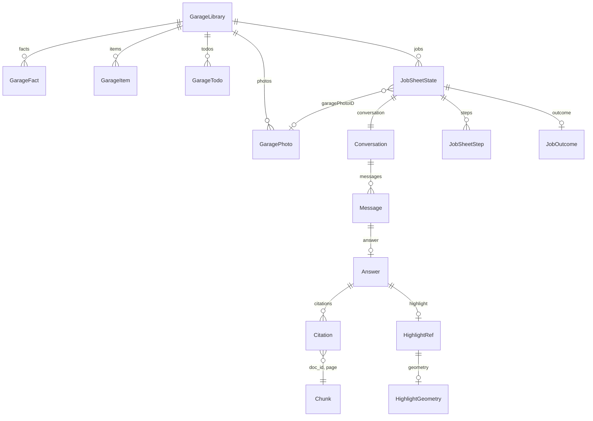

# Data schema

Reference for where Sidekick Mechanic keeps data today, and the target shape in which a job owns its chat, its steps, and its outcome. Issue #128 is the per-job chat. Issue #131 is this inventory. There is no SwiftData model anywhere in the tree.

Names below are the type names and the stored keys. Copy those names into Penpot. Where a Swift property encodes under a different JSON key, both names are in the field list.

## Current storage

Nothing in the running app is a database on the phone. The only durable owner data is one JSON file plus JPEG sidecars. Chat, the job sheet, the Jobs list, and the scan log die when the process ends.

| Entity | Lives in | Path or key |
| --- | --- | --- |
| `GarageLibrary` | Codable JSON file | Application Support `SidekickMechanic/Garage/garage.json`. `GarageLibraryStore.jsonURL` at `app/SidekickCore/Sources/SidekickCore/GarageLibrary.swift:283-284`. Root at `GarageLibraryStore.defaultRoot` lines 271-278. |
| `GaragePhoto` and `GarageItem` JPEG | File beside that JSON | `Garage/photos/<id>.jpg`. `photosURL` at `GarageLibrary.swift:287-288`. Photo write at lines 473-476. Item photo at lines 500-502. |
| Onboarding flag | UserDefaults | Key `sidekick.onboarding.completed`. `OnboardingStorage.completedKey` at `app/SidekickCore/Sources/SidekickCore/Onboarding.swift:4-6`. |
| Manual page PNG | Caches directory | `sidekick-manual-pages/<doc_id>/<page>.png`. `ManualPageLocation.cacheFile` at `app/SidekickCore/Sources/SidekickCore/ManualPage.swift:247-257`. Directory at `ManualPageConfiguration.platformCacheDirectory` lines 95-98. |
| `Conversation`, `Message`, `Answer` | Memory | `ChatViewModel.conversation` at `app/SidekickCore/Sources/SidekickCore/ChatViewModel.swift:10`. New `ConversationID` every launch at `app/SidekickMechanic/SidekickMechanicApp.swift:19`. The id is not sent on `POST /chat`. |
| `JobSheetState` | Memory | `JobSheetViewModel` comment at `app/SidekickCore/Sources/SidekickCore/JobSheet.swift:384-388`. |
| `JobSheetStep` | Not stored | Built by `JobSheetCopy.steps` at `JobSheet.swift:137-145`. Not a field of `JobSheetState`. |
| `JobHistoryRow` | Compile-time script | `JobHistoryScript.rows` at `app/SidekickCore/Sources/SidekickCore/LookBack.swift:46-77`. |
| `ScanLogEntry` | Compile-time script | `ScanLogScript.entries` at `LookBack.swift:142-169`. |
| `Chunk` | Backend files, gitignored | `backend/.ingest/chunks.jsonl` then FTS5 `backend/.ingest/index.sqlite`. Names at `backend/retrieval.py:16-17` and `backend/ingest.py:22-23`. |
| `BayMap` | JSON catalog, not user data | Schema `backend/contracts/bay_map.schema.json`. Not loaded by `POST /chat`. |
| Demo outlines | Committed JSON fixture | `backend/data/demo/demo_bay_photos.json` and the same bytes in `app/SidekickCore/Sources/SidekickCore/Resources/demo_bay_photos.json`. |
| Telemetry scenarios | Bundled JSON | `app/SidekickCore/Sources/SidekickCore/Resources/Scenarios/`. Not owner data. |

UI-test garage writes use a temporary folder when `-garageTemporaryStore` or `SIDEKICK_GARAGE_TEMPORARY` is set. `GarageStoreLocation` at `GarageLibrary.swift:216-220`.

## Current entities

### GarageLibrary

Codable file. Fields at `GarageLibrary.swift:95-99`.

| Field | Type |
| --- | --- |
| `facts` | `[GarageFact]` |
| `photos` | `[GaragePhoto]` |
| `items` | `[GarageItem]` |
| `todos` | `[GarageTodo]` |

Seed on first launch is `GarageFacts.confirmed` plus `GarageFacts.pending` at `GarageLibrary.swift:114-116` and `Onboarding.swift:88-100`. Those rows are labels the owner can edit. They are not a second copy of `docs/vehicle/TRUCK.md`.

### GarageFact

`Onboarding.swift:71-75`.

| Field | Type |
| --- | --- |
| `id` | `String` |
| `label` | `String` |
| `value` | `String` |
| `isConfirmed` | `Bool` |

`isConfirmed` is a local boolean. `GarageLibrary.confirmation` at `GarageLibrary.swift:123-127` sets it false when `value` is `TBD`, and true when a `TBD` value is edited to anything else. It does not write `TRUCK.md`.

### GaragePhoto

`GarageLibrary.swift:54-57`.

| Field | Type |
| --- | --- |
| `id` | `String` |
| `caption` | `String` |
| `fileName` | `String` |

`fileName` is `<id>.jpg` under `photos/`. Chat does not read these files.

### GarageItem

The Parts and papers row. `GarageLibrary.swift:67-71`.

| Field | Type |
| --- | --- |
| `id` | `String` |
| `name` | `String` |
| `note` | `String` |
| `photoFileName` | `String?` |

`photoFileName` is its own JPEG. It is not `GaragePhoto.id` and not `GaragePhoto.fileName` of another row.

### GarageTodo

`GarageLibrary.swift:82-85`.

| Field | Type |
| --- | --- |
| `id` | `String` |
| `title` | `String` |
| `isDone` | `Bool` |

### Conversation and Message

In memory. `Conversation` at `app/SidekickCore/Sources/SidekickCore/Conversation.swift:102-104` has `id` of type `ConversationID`, and `messages`.

`Message` encodes `role`, `id`, and either `text` or `answer`. `Conversation.swift:40-45`. A user message cannot carry `answer`. An assistant message cannot carry `text`.

`UserMessage` fields are `id` and `text`. `AssistantMessage` fields are `id` and `answer`.

### Answer

`app/SidekickCore/Sources/SidekickCore/Answer.swift:37-39`. Wire `kind` is `answer` or `refusal`.

`FoundAnswer` at lines 6-10.

| Field | JSON key |
| --- | --- |
| `text` | `text` |
| `citations` | `citations` |
| `highlight` | `highlight` |

`Refusal` at lines 21-23 has `text` and `reason`. The only reason is `not_found_in_manual`. A refusal cannot carry citations or a highlight.

### Citation

`app/SidekickCore/Sources/SidekickCore/Citation.swift:2-5`.

| Field | JSON key |
| --- | --- |
| `docID` | `doc_id` |
| `page` | `page` |
| `snippet` | `snippet` |

`page` is the 1-based PDF index, not a printed folio. The phone does not check the snippet against the page image.

### HighlightRef

`app/SidekickCore/Sources/SidekickCore/HighlightRef.swift:3-8`.

| Field | JSON key |
| --- | --- |
| `bayPhotoID` | `bay_photo_id` |
| `partID` | `part_id` |
| `display` | `display` |
| `geometry` | `geometry` |
| `isDemo` | `demo` |

`HighlightDisplay` is `outline` or `confirm`. `HighlightGeometry` has `polygons`. Each polygon has `points` of `x` and `y`. Those point fields are not range-checked in Swift. The bay-map schema requires 0 to 1.

A non-demo card does not draw this geometry. `AnswerCardView.swift:33-37` shows a placeholder unless demo mode has an image.

### JobSheetState

Session only. `JobSheet.swift:274-289`. `id` is computed from `sourceMessageID`. It is not its own stored key.

| Field | Type | Notes |
| --- | --- | --- |
| `sourceMessageID` | `MessageID` | Also the Identifiable `id`. |
| `title` | `String` | |
| `answerText` | `String` | Copy of the assistant text. `attachPhoto` can replace it and leave `citations` alone. |
| `citations` | `[Citation]` | |
| `photoID` | `String?` | Demo catalog `photo_id`. Not a `GaragePhoto.id`. |
| `highlight` | `HighlightRef?` | |
| `detent` | `JobSheetDetent` | `collapsed`, `half`, or `full`. UI only. |
| `outcome` | `JobOutcome?` | `worked`, `partly`, or `didnt`. |
| `notes` | `String` | |
| `tags` | `[String]` | |
| `whatFixed` | `String` | |

`JobSheetStep` at `JobSheet.swift:73-76` has `id` as an `Int`, `title`, and `isComplete`. The half sheet asks `JobSheetCopy.steps` for two steps. The job does not own them.

### JobHistoryRow and ScanLogEntry

Not the live job. `JobHistoryRow` at `LookBack.swift:27-30` has `job` of type `JobSheetState`, and `dateLabel`. `id` is `job.id`.

`ScanLogEntry` at `LookBack.swift:104-108` has `id`, `photoID`, `source` of type `HighlightViewerState`, and `tagLabel`. `photoID` is a demo catalog id. There is no foreign key to `JobSheetState` or `GaragePhoto`.

### Chunk

JSONL object from `backend/ingest.py:30-34`.

| Field | Type |
| --- | --- |
| `doc_id` | `str` |
| `page` | `int` |
| `text` | `str` |

`backend/retrieval.py` defines a second `Chunk` with the same three fields at lines 73-77. The FTS table adds `labels`, derived at index time. Schema at `backend/retrieval.py:28-36`.

| Column | Indexed |
| --- | --- |
| `doc_id` | no |
| `page` | no |
| `labels` | yes |
| `text` | yes |

`Citation.doc_id` plus `Citation.page` is the logical key into this table. Nothing in the app enforces it.

### Bay map

Schema object, not the phone store. `backend/contracts/bay_map.schema.json:7-18`.

`BayMap` requires `schema_version`, `coordinate_space`, `parts`, `photos`.

`part` requires `part_id`, `display_name`, `aliases`.

`photo` requires `bay_photo_id`, `angle_id`, `image_size` with `width` and `height`, `source` with `kind` and `reference`, `license` with `name` and `reference`, and `regions`.

`region` requires `part_id`, `polygons`, `confirmation`. `confirmation.kind` is `confirmed` or `unconfirmed`. Confirmed also has `confirmed_by`.

`HighlightRef` can name a `bay_photo_id` and `part_id` in this catalog. Default `POST /chat` does not load the file.

### Demo photo fixture

Top-level keys in `backend/data/demo/demo_bay_photos.json` include `what`, `coords`, `generated`, and `photos`. Each photo includes `photo_id`, `image_file`, and `parts`. That `photo_id` is what `JobSheetState.photoID` and `ScanLogEntry.photoID` use. Header at line 2 says the polygons are scripted and the photos are not the owner's truck.

## Current relationships

`GarageItem.photoFileName` is a file name, not a `GaragePhoto` row. `JobSheetState.photoID` and `ScanLogEntry.photoID` point at the demo fixture, not at `GaragePhoto`. `JobSheetStep` is absent from this diagram because the job does not store it. `ScanLogEntry` has no relationship to a job.

## Proposed target

One phone still has one `GarageLibrary`. Jobs are a second Codable file, `SidekickMechanic/jobs.json`, next to `Garage/` under Application Support. Same pattern as `garage.json`. Not SwiftData. Not the backend.

`JobSheetState` becomes the persisted root. It owns one `Conversation`, the `steps` array, and `outcome`. Chat text stays on `Message` and `Answer` only. The job stops keeping its own `answerText`, `citations`, and `highlight`. Those copies are how the sheet can show scripted text beside an older citation.

New fields use the existing spelling.

| Entity | Field | Change |
| --- | --- | --- |
| `JobSheetState` | `id` | Stable `String`. Today `id` is `sourceMessageID`. |
| `JobSheetState` | `conversation` | Owned `Conversation`. Opening the job loads these messages. Issue #128. |
| `JobSheetState` | `steps` | Owned `[JobSheetStep]`. Today `JobSheetCopy.steps` builds them and does not save `isComplete`. |
| `JobSheetState` | `outcome` | Already on the struct. Persist it. |
| `JobSheetState` | `dateLabel` | Move off `JobHistoryRow` onto the job. The Jobs list is the job file. |
| `JobSheetState` | `garagePhotoID` | Optional `GaragePhoto.id`. Today's `photoID` stays the demo catalog id until a real photo is attached. |
| `JobHistoryRow` | | Drop as stored data. The list is `[JobSheetState]`. |
| `ScanLogEntry` | | Do not add a table. Filter highlights on the job's assistant messages. |
| `JobSheetState` | `detent` | Leave as UI state. Do not persist it. |
| `JobSheetState` | `sourceMessageID`, `answerText` | Remove once `conversation` is the only chat. |

`GarageFact`, `GaragePhoto`, `GarageItem`, and `GarageTodo` stay on `GarageLibrary`. A job does not own the garage. `garagePhotoID` is the only link.

`Chunk`, the bay map, and the demo fixture stay where they are. `Citation` still points at `doc_id` and `page`.

`JobSheetState` fields in that diagram are `id`, `title`, `notes`, `tags`, `whatFixed`, `photoID`, `dateLabel`, `garagePhotoID`, `conversation`, `steps`, and `outcome`.

`JobSheetStep` fields stay `id`, `title`, and `isComplete`.

`JobOutcome` values stay `worked`, `partly`, and `didnt`.
