# User journey (for owner review)

Design only. **Nothing here gets built until Zeke reviews it.**

Sidekick Mechanic is a chat-first mechanic on iPhone for one truck: the 1990 Land Cruiser LJ78 with a 2JZ-GE swap. The 2JZ-GE is naturally aspirated (it does not have a turbo). You describe a problem in chat. The app answers from the manuals with page citations, and shows the part outlined on a photo.

This page is the map. Wireframes are grayscale boxes with fake copy (`FAKE-DOC-2JZ`, `p. 999`). They are not the truck.

## Words used here

| Word | Meaning |
| --- | --- |
| **Job** | One problem you asked about. “Cold idle” is a job. |
| **Job sheet** | One card that holds everything for that job: photo, answer, steps, notes, tags, outcome. It slides up from the bottom of chat. |
| **Citation chip** | A pill that names a manual and a page. Tap it to see that page. Example in these frames: `FAKE-DOC-2JZ · p. 999`. |
| **Traced photo** | A photo where the part outlines have already been drawn by hand. |
| **Untraced photo** | A new snap. No hand-drawn outline exists for it yet. |
| **Reference photo** | A stand-in 2JZ bay photo, clearly labeled **not your truck**. |
| **TBD** | We do not know yet. We will not guess. Facts live in `docs/vehicle/TRUCK.md`. |

## What already exists

Chat, answer cards, and citation chips already ship. Draft demo PRs [#92](https://github.com/zeketx/sidekick-mechanic/pull/92) and [#93](https://github.com/zeketx/sidekick-mechanic/pull/93) add three highlight states on public 2JZ photos (not your truck):

| State | What you see |
| --- | --- |
| **Confident** | A precise outline on the photo. |
| **Unsure** | “Is this it?” with Yes / Not this. **Internal only, behind a flag.** Not shown to you in v1. |
| **Not found** | No outline, plus a pointer to the manual diagram page. |

Draft design PR [#89](https://github.com/zeketx/sidekick-mechanic/pull/89) (`open-world-part-masks.md`) locks the v1 rule for a new photo: **no outline on your own untraced photo.** The part is outlined on the closest traced reference photo, labeled “reference, not your truck,” with a diagram link and a retake hint. Retake angles stay **TBD** until they are confirmed in `TRUCK.md`.

## Journey

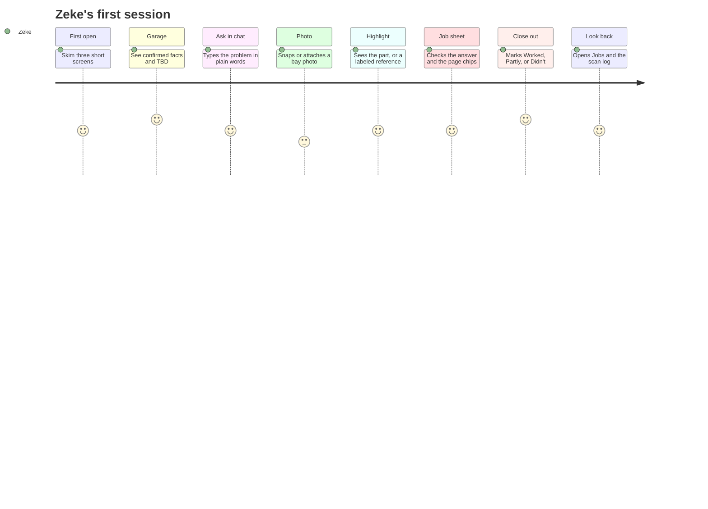

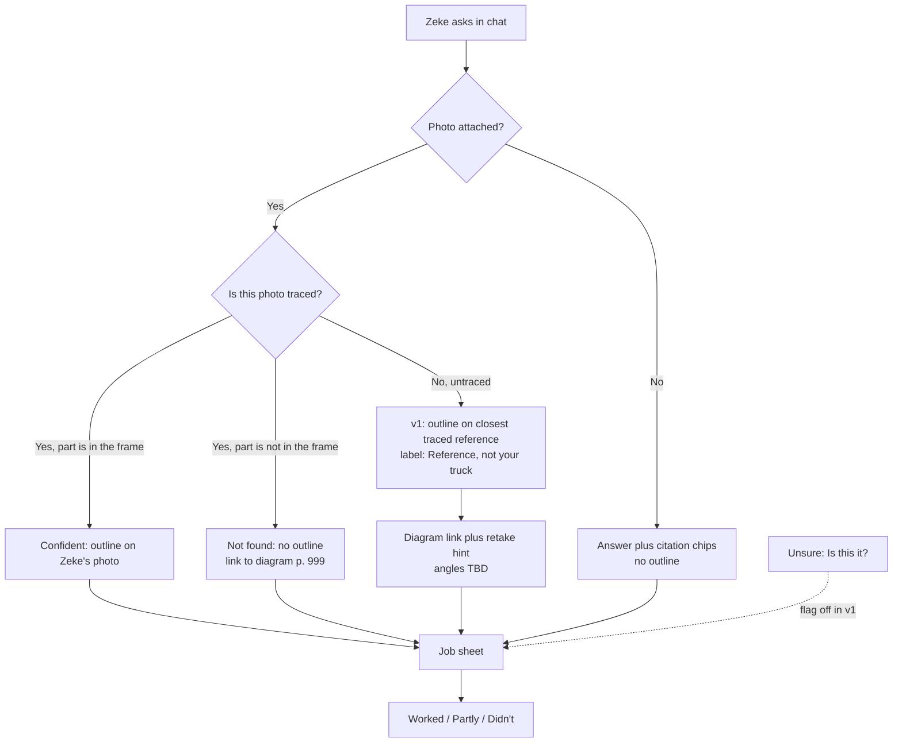

## Stages

Feelings are a guess for you to correct.

| Stage | What Zeke does | What the app shows | How he feels | Opportunities |
| --- | --- | --- | --- | --- |
| First open | Opens Sidekick. Skims or skips. | Three short screens: what it is, how chat + citations + outlines work, then garage. | Curious. Does not want a lecture. | Keep it to three screens. Skip is always available. No animation in v1. |
| Garage setup | Looks at truck facts. Does not fill in guesses. | Confirmed rows from `TRUCK.md`. Everything else is TBD. Donor year, OBD type, harness, photo angles stay TBD. | Relieved that TBD is allowed. | Never prompt for a spec, pin, or part number. Do not invent angles. |
| Ask in chat | Types the problem in everyday words. No part names required. | Chat as today. Empty state: “Describe a problem.” | Hopeful. Slightly unsure he asked it “right.” | Suggested prompts can wait. v1 is a blank composer plus Send. |
| Snap or attach | Takes a bay photo or picks one from the library. | Camera or library. Photo attaches to **this job**, not a global album. | A bit awkward under the hood. | One attach control. Retake later if the outline cannot use this frame. |
| Highlight card | Opens the photo full-screen. Pinches to zoom. | **Confident:** outline on his photo. **Not found:** no outline, diagram link. **Reference:** outline on a labeled stand-in. **Unsure:** hidden in v1. | Delight if the line is on the right thing. OK if it is honest about a miss. | Never draw a guessed outline on his untraced photo. Tag chips on the card can wait. |
| Work the job | Reads the answer, taps citation chips, follows steps at the truck. | Job sheet (half, then full). Photo, answer, chips, optional steps. | Focused. Hands may be dirty — large tap targets. | v1: photo + answer + chips. Steps, notes, and tags are later. |
| Close out | Marks Worked / Partly / Didn't. Optionally what fixed it. | Three outcomes on the job sheet. Optional one-line note. | Done, or still stuck but recorded. | Do not require a part name to close. Tags can be added later. |
| Look back | Opens Jobs, then the scan log. | Job list with outcome badges. Scan log: a grid of past photos, filterable by tags. | Proud he has a log. Useful for a portfolio clip. | Both screens are later. v1 can live without history. |

## Wireframes

Low-fi. iPhone frame. Placeholder bay, not your truck. Fuchsia outline in the real app; here it is a black line.

### Onboarding

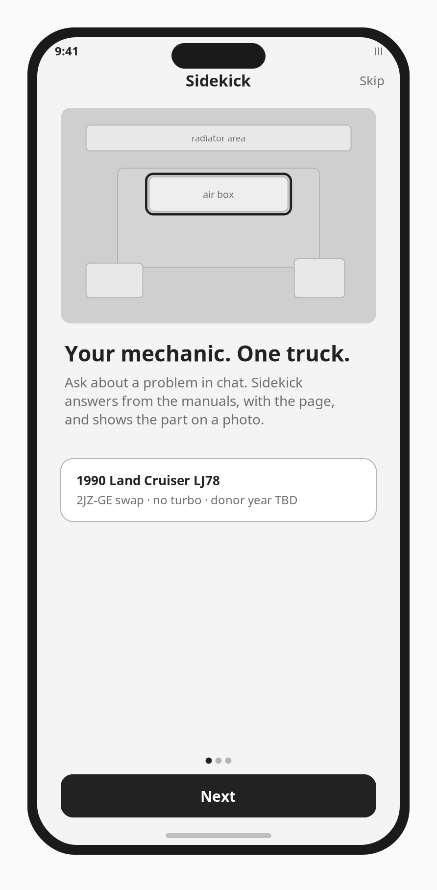

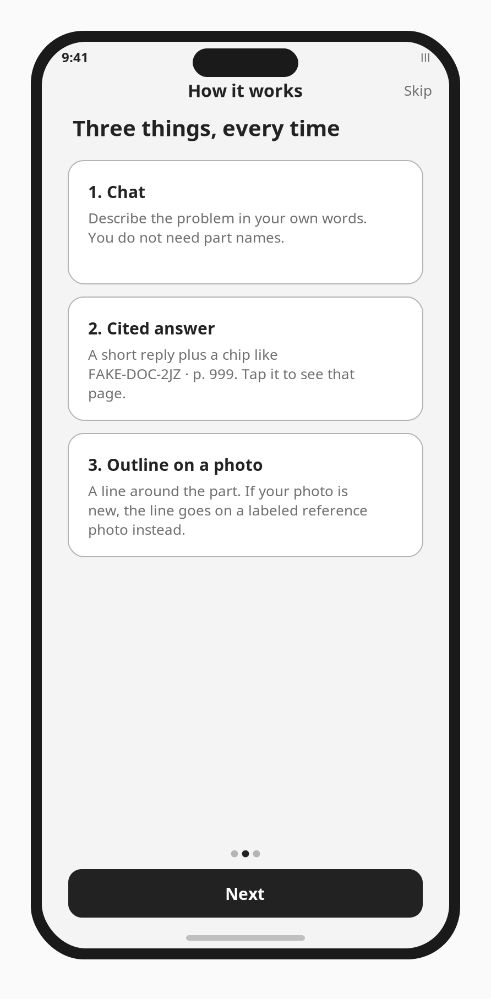

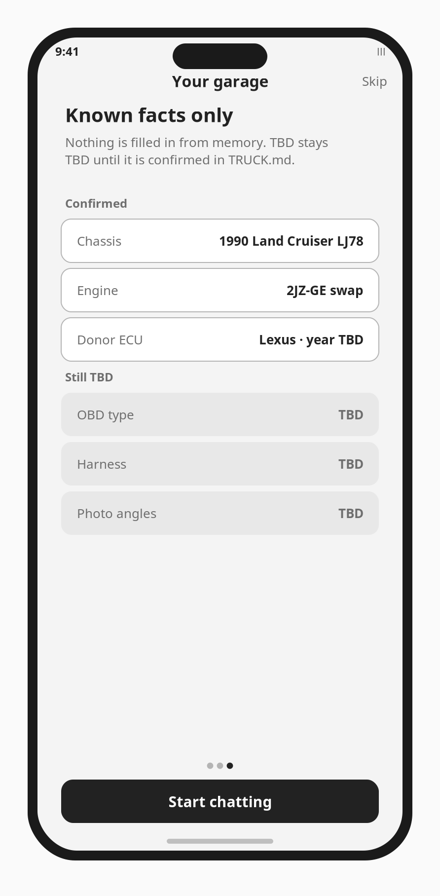

### Chat and job sheet

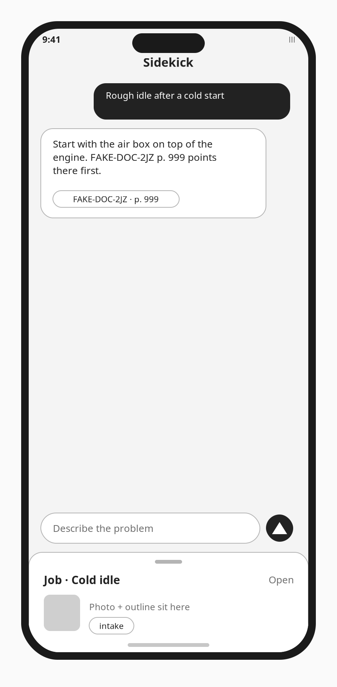

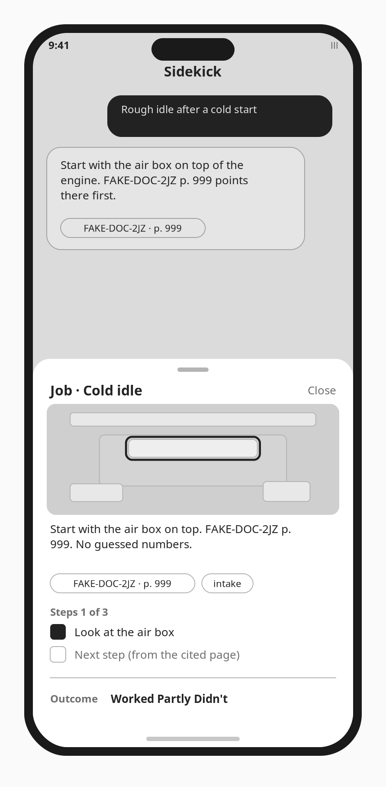

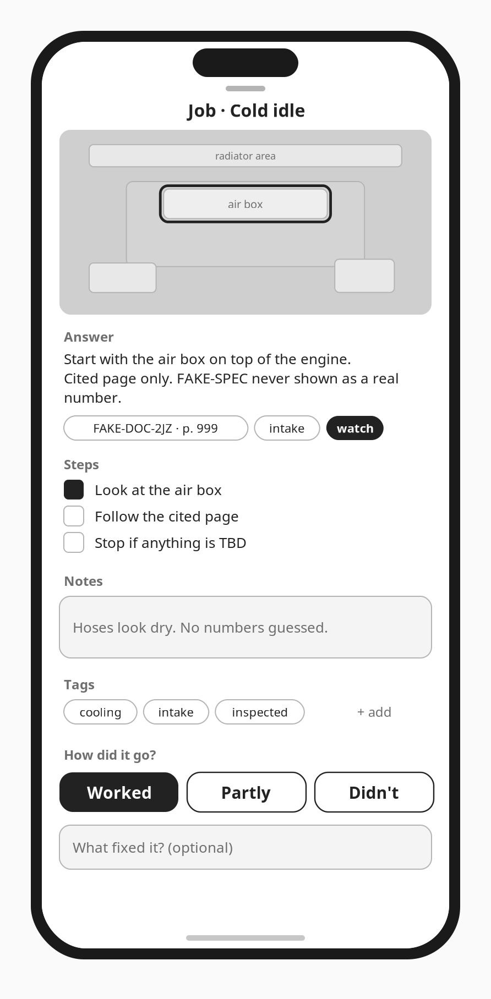

### Highlight card

Tinder-style full-bleed card. Pinch-to-zoom control on the card. Tag chips sit on the card.

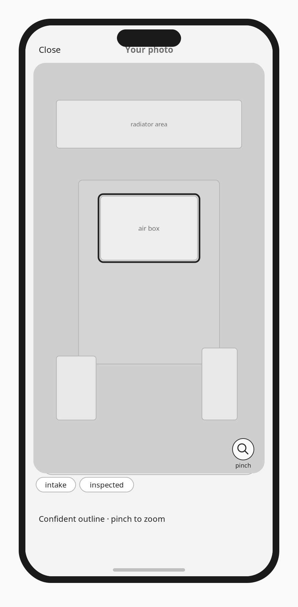

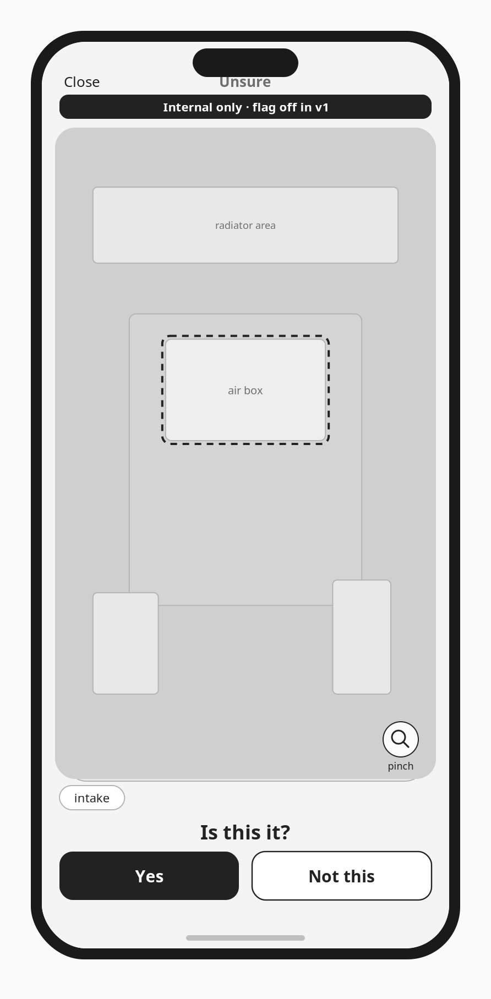

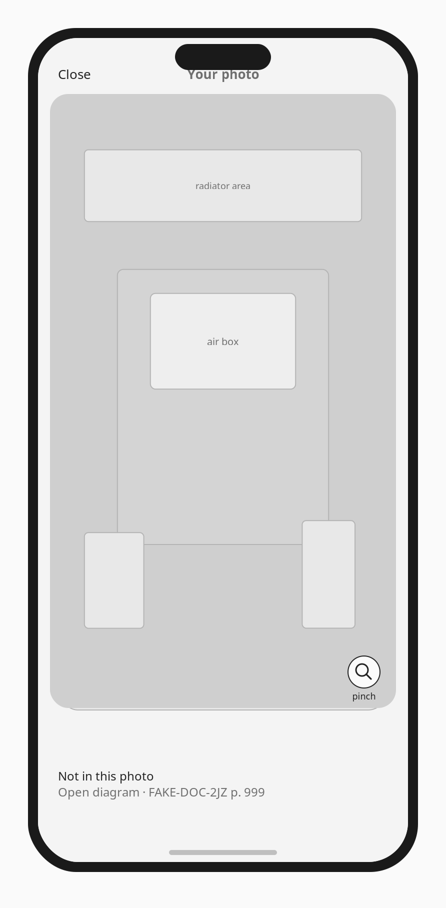

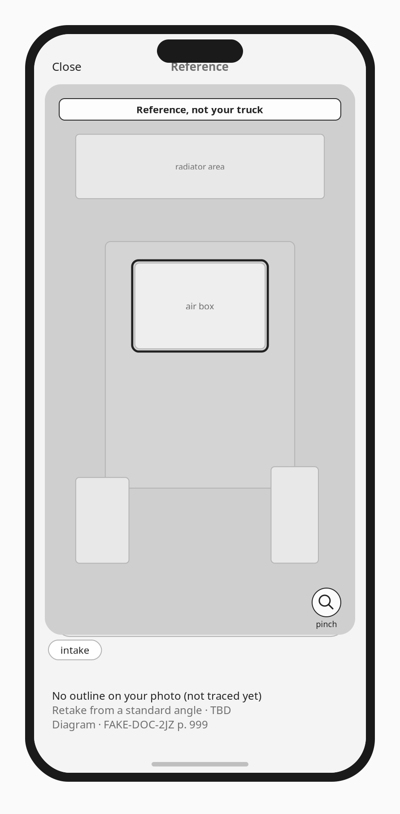

### Look back

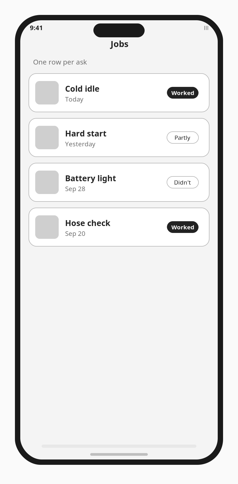

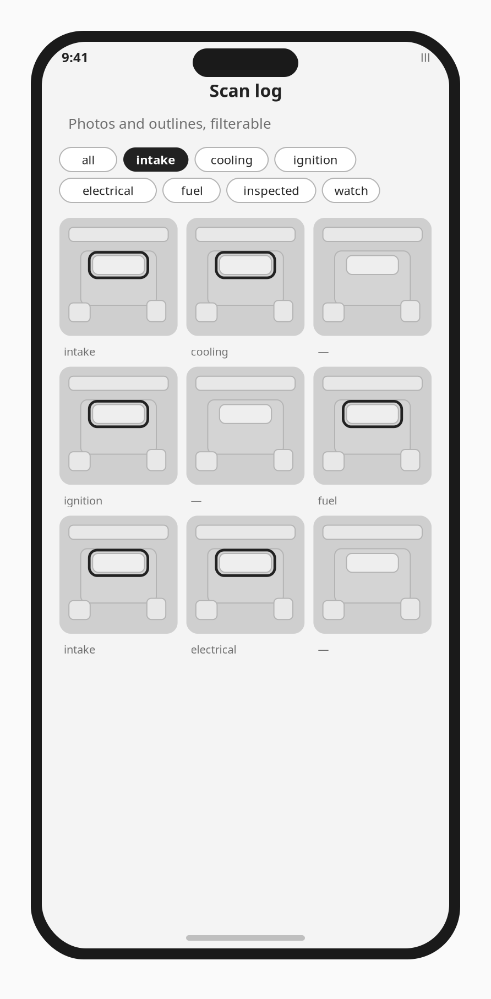

Regenerate frames with `python3 docs/design/wireframes/generate_wireframes.py`.

## v1 vs later

The Cursor plan window ends around **12 Oct 2026**. v1 stays lean.

**v1 (build after review):** three onboarding screens, garage TBD list, chat + attach photo, highlight card (confident / not found / reference), pinch to zoom, job sheet collapsed + half, close-out (Worked / Partly / Didn't).

**Later:** onboarding animation, user-facing Unsure, full job sheet (steps, notes, tags), job history, scan log.

Stories: [user-stories.md](user-stories.md). Animation ideas: [onboarding-animation-ideas.md](onboarding-animation-ideas.md).

## Open questions for Zeke

1. **Home.** Is chat-plus-job-sheet the right home after Send, or should the highlight card take over the screen first?
2. **v1 job sheet.** Photo + answer + chips + outcome only — or do you also want steps in v1?
3. **Close-out.** Is “what fixed it?” a free-text line, a tag, or skip it in v1?
4. **Unsure.** Keep “Is this it?” hidden in v1 (as #89 says), even in the demo?
5. **History.** For Oct 12, is a job list enough, or do you want the scan-log grid too?
6. **Photo.** Camera, library, or both in v1?
7. **Reference photos before delivery.** Keep using the public 2JZ-GE bays from the demo, always labeled “not your truck”?
8. **Retake angles.** Wait for `TRUCK.md`, or show the five planned ids from `DAY_ONE.md` as “planned, not confirmed”?
9. **Does a job equal one chat ask**, or can follow-up messages stay on the same job?
