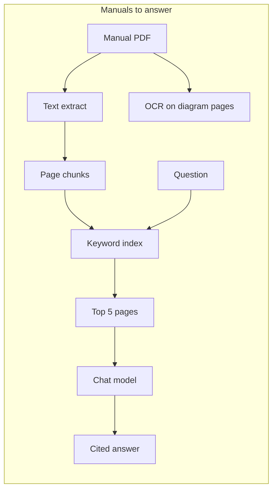
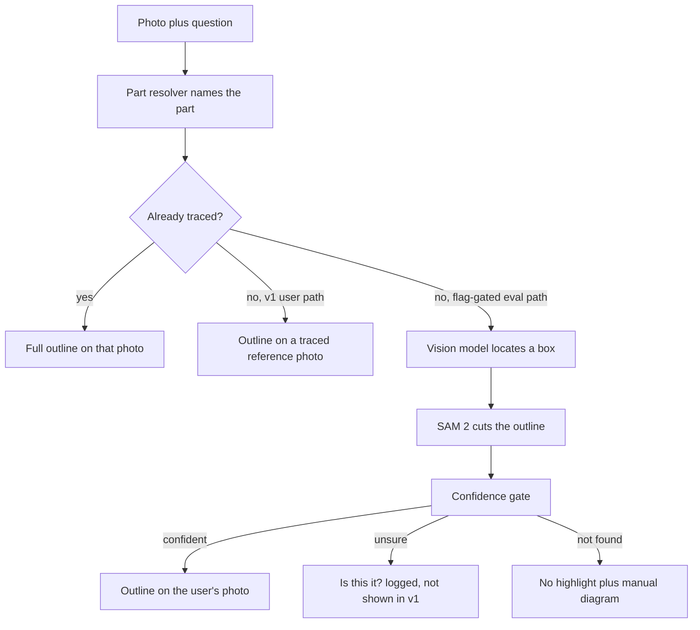

# ML checklist (teaching doc)

A hands-on map of every machine-learning job in Sidekick Mechanic, written so you can do the work yourself.

This is not a new design. It restates what the repo, the issues, and the draft design already say. The highlight design lives in draft [PR #89](https://github.com/zeketx/sidekick-mechanic/pull/89) (`docs/design/open-world-part-masks.md` on branch `cursor/open-world-part-masks-8e59`). That file is not on `main` yet.

**Spike numbers on this page are preliminary and agent-judged.** They are not a scored run against your hand labels. Treat them as a first look, not a ship decision.

Hours next to each item are **estimates**.

---

## One-screen overview

Do the work in this order. Checkboxes mark the item, not whether it is done. Status is in each section.

| # | Do this | Why this order |
| --- | --- | --- |
| 1 | Chat model via OpenRouter | Answers need a live model before you measure them |
| 2 | Manual ingest (text out of PDFs) | Retrieval has nothing to search until pages are files |
| 3 | Keyword index + recall@5 | Prove the right pages come back *before* you trust the answer |
| 4 | Golden questions eval | A fixed exam so quality is a number, not a vibe |
| 5 | Label Studio + held-out photo set | **You are here.** Labels are the answer key; they gate the next spike |
| 6 | Read the first highlight spike | So you do not rebuild a path that already failed the 5% bar |
| 7 | Follow-up spike (stronger locator + reference crops) | Locating the part was the bottleneck, not drawing the outline |
| 8 | Confidence gate (3 states) | A wrong outline is worse than no outline |
| 9 | Engineer design PR | Lock the v1 call before changing the answer schema |
| 10 | Answer contract v2 | Phone, backend, and eval must share one highlight shape |
| 11 | Reference-photo fallback | v1 user path for a photo nobody has traced |
| 12 | "Is this it?" taps as data | Extra labels, flag-gated, not shown to users in v1 |
| 13 | Confidence UX | What the owner sees in each state |
| 14 | Highlight acceptance eval | M3 exit is a script, not adjectives |
| 15 | Phone renderer + chat-to-highlight | After the contract and states exist |
| 16 | Your truck's bay map (after delivery) | Swap public photos for your bay |
| 17 | Phase 2 YOLO dry run | Later. Live camera. Do not start unless the issue says so |

Demo-mode [PR #92](https://github.com/zeketx/sidekick-mechanic/pull/92) / [PR #93](https://github.com/zeketx/sidekick-mechanic/pull/93) are a playground with **scripted** outlines. They are not the ML pipeline. Use them to try the chat UI. Do not treat their highlights as model output.





v1 ships the traced path and the reference-photo path. The locate → SAM 2 → gate path keeps running behind a flag until human labels clear the bars in [How to know it's working](#how-to-know-its-working).

---

## 1. Chat model and cost via OpenRouter

- [ ] **What it is.** The chat backend talks to any OpenAI-shaped `/v1/chat/completions` host. You point it at [OpenRouter](https://openrouter.ai/) and pick a model slug, for example `x-ai/grok-4.3`.
- **Why it matters.** This is the voice that answers you in the garage. The highlight spike uses the same vendor for vision. Cost stays visible on one dashboard.
- **Order.** 1. Do this first so `/chat` and later vision calls have a key.
- **Difficulty.** Easy. About 1 hour (estimate) to copy `.env` and send one chat.
- **Status.** Done for chat. [backend/llm.py](../../backend/llm.py) and [backend/.env.example](../../backend/.env.example). Vision keys for the spike are a separate env var in the design (`OPENROUTER_API_KEY`); that line is **to be added** to `.env.example`. Product keys live as a Railway secret. Never commit a key.

### Hands-on

From `backend/`:

```bash
cp .env.example .env
# edit .env — never commit it
```

OpenAI-compatible vars (these exist):

| Variable | What you set for OpenRouter |
| --- | --- |
| `SIDEKICK_LLM_API_KEY` | Your OpenRouter key |
| `SIDEKICK_LLM_BASE_URL` | `https://openrouter.ai/api/v1` |
| `SIDEKICK_LLM_MODEL` | e.g. `x-ai/grok-4.3` |
| `SIDEKICK_LLM_TIMEOUT_SECONDS` | default `30` |
| `SIDEKICK_LLM_MAX_RETRIES` | default `2` |

```bash
set -a && source .env && set +a
uvicorn app:app --reload --host 127.0.0.1 --port 8000
```

Leave `SIDEKICK_LLM_API_KEY` empty and the backend uses `FakeLLMClient` (no network). Watch spend on the OpenRouter dashboard. Chat budget in [VISION.md](../../VISION.md): p50 under 4 s, p95 under 8 s, send to render. Highlight budget: **≤ $0.03 per photo**.

The first highlight spike used OpenRouter as `google/gemini-2.5-flash` and spent **$0.20** total (about **$0.001–$0.005 per photo**). Those figures are preliminary.

---

## 2. Manual ingest (text out of PDFs)

- [ ] **What it is.** Turn each verified manual PDF into one text chunk per page, tagged with document id and page number.
- **Why it matters.** If the page is not in the chunk file, the app cannot cite it. A guessed torque or pin can break a part or hurt someone.
- **Order.** 2. After the chat model, before search.
- **Difficulty.** Easy to re-run once the PDFs and hashes are on disk. About 2–4 hours (estimate) the first time you place files and fill [docs/MANUALS.md](../MANUALS.md). The script itself is done.
- **Status.** Done. `backend/ingest.py`. Inventory still has `TBD` hashes until your copies are recorded. [docs/MANUALS.md](../MANUALS.md).

**OCR** (optical character recognition: reading text out of a picture of a page) is **not** inside `ingest.py`. Ingest uses `pypdf` on the PDF text layer. OCR showed up in two other places:

- The wiring-diagram spike, which compared text extraction to Tesseract on fake pages and recommended citing the **page image** for diagrams, not OCR snippets. [docs/design/wiring-diagram-spike.md](../design/wiring-diagram-spike.md).
- Checking golden-question pages on your machine (`pdftotext` / `tesseract`) when [PR #83](https://github.com/zeketx/sidekick-mechanic/pull/83) was written. [backend/eval/GOLDEN.md](../../backend/eval/GOLDEN.md).

Think of ingest as photocopying each page into a searchable notebook. OCR is a separate attempt to read a photo of a wiring diagram. The spike said: show the owner the picture; do not trust OCR as a citation.

### Hands-on

Put PDFs at `manuals/<id>.pdf` (gitignored). Hash the file you have. Do not invent a checksum.

```bash
sha256sum manuals/2jz-ge-rm.pdf
```

From `backend/`:

```bash
python3 manifest.py
python3 ingest.py
```

That writes `backend/.ingest/chunks.jsonl` and `backend/.ingest/report.json`. Empty pages (no extractable text) land in the report. Those are often diagram pages.

Wiring spike only (needs `tesseract-ocr`, `poppler-utils`, `fonts-dejavu-core`):

```bash
python3 spikes/wiring_spike.py --output eval/results/wiring-spike.json
```

---

## 3. Keyword index and recall@5

- [ ] **What it is.** A local SQLite word index (FTS5: a built-in "find these words" engine). A search returns the top 5 pages. **Recall@5** is: of the pages we already know are right, how many showed up in those 5.
- **Why it matters.** If search misses the page, the model never sees it, and you get a refusal or a weak answer. Target in [VISION.md](../../VISION.md): **recall@5 ≥ 0.85**.
- **Order.** 3. After ingest, before you treat chat answers as measured.
- **Difficulty.** Index: done. Measuring recall on real manuals: easy–medium, about 2–4 hours (estimate) once ingest has run.
- **Status.** Index done. [docs/design/retrieval-index.md](../design/retrieval-index.md), `backend/retrieval.py`. Current [docs/METRICS.md](../METRICS.md) lists recall@5 as **not available**: the default eval runner does not pass retrieval hits (cited pages are not counted as hits).

This is a concordance, not a "meaning" search. It finds the words you typed. That is on purpose: workshop questions are part names and symptoms, and citations must land on a real page.

### Hands-on

From `backend/`, after ingest:

```bash
python3 retrieval.py build
python3 retrieval.py query "starter motor" --k 5
```

`build` replaces `backend/.ingest/index.sqlite`. `POST /chat` searches that file when it exists.

From the repo root, after a real index exists:

```bash
make eval
```

`make eval` runs the golden set through in-process `/chat` with the fake LLM and rewrites [docs/METRICS.md](../METRICS.md). `make metrics` rebuilds the doc from the latest results file without re-asking questions.

A later hillclimb that swaps the index engine is allowed. Do not start embeddings unless recall@5 stalls on paraphrase. That call is already written down in the retrieval design.

---

## 4. Golden questions eval

- [ ] **What it is.** A fixed list of 52 real questions with known answer pages, plus questions the manuals cannot answer (the right output is "not found").
- **Why it matters.** Same exam every time, so a change to search or the model is a before/after number, not "it felt better."
- **Order.** 4. The answer-side exam. Highlight scoring for untraced photos moves to item 5 and item 14.
- **Difficulty.** File is done. Owner review: easy, about 2–3 hours (estimate). A live run against ingested manuals: about 2–4 hours (estimate).
- **Status.** File landed in merged [PR #83](https://github.com/zeketx/sidekick-mechanic/pull/83). [Issue #23](https://github.com/zeketx/sidekick-mechanic/issues/23) is still open: **owner approval pending**. 52 rows (40 answerable, 12 unanswerable, 15 with a `part_id`, 13 in the CI subset). [backend/eval/GOLDEN.md](../../backend/eval/GOLDEN.md).

The 15 `part_id` rows are the text-side expected part. Scoring an outline on a brand-new photo is [issue #84](https://github.com/zeketx/sidekick-mechanic/issues/84) / [issue #88](https://github.com/zeketx/sidekick-mechanic/issues/88), not this file.

### Hands-on

From `backend/`:

```bash
python3 -m pytest
python3 -m eval --golden eval/golden.jsonl --output-dir /tmp/golden-eval
python3 -m eval --golden eval/golden.sample.jsonl --ci
```

From the repo root:

```bash
make eval
```

CI runs the sample subset (`ci: true` rows), not the full 52. Results go to `backend/eval/results/<date>.json`. Do not type metrics by hand. Do not put manual PDFs or page images in git.

Without ingested manuals, citation accuracy and refusal correctness stay 0. That is expected.

---

## 5. Held-out photo set and Label Studio

- [ ] **What it is.** A small stack of public 2JZ bay photos you outline by hand, kept secret from the pipeline while you tune. Those outlines are the answer key.
- **Why it matters.** Without a hidden test, you are grading the homework with the answer sheet in view. A highlight that looks sharp can still be the wrong part.
- **Order.** 5. **Next.** Official M3 order starts here: [#84](https://github.com/zeketx/sidekick-mechanic/issues/84) → #85 → design → #86 → #87 → #31 → #33 → #88. The Product Lead call made finishing this queue the gate for the follow-up spike.
- **Difficulty.** Medium. The prepared queue is about **1 hour** (15 photos, ~64 polygons). Growing it to the full #84 set (~20 photos, ~100–160 photo×part queries) is about 4–8 hours (estimate).
- **Status.** In progress. Workflow is merged ([docs/BAY_MAP.md](../BAY_MAP.md), `backend/bay_map_labels.py`). The #84 manifest, query list, and size tags are **not started**. A Label Studio queue of 15 photos / ~64 polygons was prepared for you (from the #89 spike notes). [#27](https://github.com/zeketx/sidekick-mechanic/issues/27) prototype photos are the **tune / dev** split. **#84 stays held out.**

### Tune vs held-out, in one picture

Imagine practicing free throws. The driveway is practice (tune). Game day is a different gym (held-out). If you raise the hoop on the driveway until you never miss, and then score yourself on that same driveway, the number is a lie.

- **Tune / dev:** [issue #27](https://github.com/zeketx/sidekick-mechanic/issues/27) photos in `backend/data/prototype_bay_photos.json`. Today that verified 2JZ-GE set is small (one committed GE bay frame). Use it to pick score cutoffs.
- **Held-out:** [issue #84](https://github.com/zeketx/sidekick-mechanic/issues/84). About 20 public photos, **disjoint** from #27 and from any photo used to tune. Report ship-bar numbers only here.
- The first-pass spike's own recalibration split (agent-judged, preliminary): tune = #27 plus 4 test photos picked by lowest `sha1(photo_id)` *before* tuning; 10 photos held out. That split is not a substitute for #84.

Eval labels are **polygons** (an outline you click around the part). A box is not an eval label. A brush mask is rejected; redraw it as a polygon.

Starting part list (locations only, no specs): throttle body, intake plenum, coil packs (group), alternator, serpentine belt, oil filler cap, oil dipstick, radiator cap plus upper hose, battery terminals, fuse/relay box. Tag each labeled part **large / medium / small-or-thin**. Include true **not visible** queries (part not in the frame).

### Hands-on

Label Studio is not a backend dependency. Install it on its own.

```bash
pip install label-studio
label-studio start
```

Fetch prototype stand-ins (gitignored images):

```bash
cd backend
python3 prototype_photos.py validate
python3 prototype_photos.py fetch
```

Images land in `bay-photos/prototype/` (gitignored). Import those files, or the #84 files once you have them. Paste the polygon config from [docs/BAY_MAP.md](../BAY_MAP.md). Real part ids are short ids you choose, not catalog numbers. Fixture leftovers stay `FAKE-*`.

Export **JSON** (the task array, not JSON-MIN):

```bash
label-studio export <project-id> JSON --export-path=<output-path>
```

Convert (this command exists):

```bash
cd backend
python3 bay_map_labels.py \
  --export /path/to/label-studio.json \
  --manifest /path/to/manifest.json \
  --output /path/to/bay-map.json
```

The #84 committed manifest, query list, and size-bucket tags are **to be added**. License text is copied from the source, never typed from memory. Do not commit JPEGs.

---

## 6. First highlight spike (what already ran)

- [ ] **What it is.** A time-boxed bakeoff of three ways to outline a part on a photo nobody has traced. [Issue #85](https://github.com/zeketx/sidekick-mechanic/issues/85).
- **Why it matters.** You need to know which recipe is even in the game before you build the phone around it.
- **Order.** 6. Already run once. Read it before you spend more API money.
- **Difficulty.** The first pass is done (agent-judged). Re-reading and deciding the follow-up: easy, about 1–2 hours (estimate).
- **Status.** In progress. Issue still open. Scripts and results **not committed** (noted in #89). Design write-up is draft [PR #89](https://github.com/zeketx/sidekick-mechanic/pull/89). Product call is on the #85 thread (2026-10-03).

Three candidates:

| Path | Recipe | Result (preliminary, agent-judged) |
| --- | --- | --- |
| **A** (preferred) | A vision model draws a box / points. **SAM 2** (Segment Anything 2: a model that cuts a tight outline from a hint) cuts the mask | Live candidate. Confirm band 14/22 right. After recalibration, 7/13 held-out outlines wrong |
| **B** (open baseline) | **Grounding DINO** (an open model that finds a box from a text name) + SAM 2 | Weak. Tiny DINO often one huge box |
| **C** | The vision model draws the mask itself | **Dropped.** 15/33 confident outlines wrong (46%, 95% CI 30–62%) |

Run shape: 15 licensed public photos, mostly **2JZ-GTE**, not your truck. #27 GE prototype = dev. 14 test × 10 parts = **140 queries** per pipeline. **No IoU** (no answer key). OpenRouter total **$0.20**. Cost about **$0.001–$0.005 / photo** (A $0.0034, B $0.0008, C $0.0035). CPU p95 4.1 s / 8.1 s / 6.5 s — **not GPU**, so not the 8 s ship bar.

Recalibration finding, in plain language: SAM's own scores measure **how clean the cut is**, like how neatly a cookie cutter came out of the dough. They do **not** measure whether you aimed at the right cookie. Wrong outlines often had SAM scores of 0.94–0.96. **Locating is the bottleneck.** No SAM cutoff fixed wrong-part locates. Decision-rule result: **stop and rethink** for confident outlines on the user's untraced photo.

### Hands-on

Spike scripts were planned under `backend/spikes/` and are **to be added** (not in the tree). Do not fold a winner into `/chat` in a spike PR. Do not score #27 as the ship bar.

---

## 7. Highlight pipeline (vision model locates, SAM 2 cuts)

- [ ] **What it is.** Path A: a vision-language model (a model that looks at a picture and reads a name) returns a box or points on the part; SAM 2 turns that hint into a precise outline. A box is never what the owner sees.
- **Why it matters.** The person asking does not know part names. Pointing at the right thing is the product. It has to work on a still photo that has never been traced.
- **Order.** 7. After labels exist. Official next step after #84 is this spike; the follow-up is a stronger locator plus traced reference crops, scored on **your** #84 labels.
- **Difficulty.** Hard. About 12–24 hours (estimate) for a time-boxed follow-up, matching the original 2–3 day box.
- **Status.** Not started for the follow-up. First pass done (item 6). C is dropped. B stays the open baseline. Approved follow-up is on [issue #85](https://github.com/zeketx/sidekick-mechanic/issues/85).

v1 **does not** draw this outline on the user's untraced photo. That path stays flag-gated. See item 11.

### Hands-on

**To be added** (named in #89, not in the repo yet):

- `backend/spikes/` scripts for A (and B)
- Results JSON under `backend/eval/results/` (never hand-typed)
- `OPENROUTER_API_KEY` in the environment (spike). Product: Railway secret

When those scripts land, the design says: downscale the locate image (long side 1024), measure p95 on a **GPU**, skip locate when the photo already has a confirmed traced region, write cost on the results file. Watch the OpenRouter dashboard.

Existing tools you will reuse: Label Studio + `bay_map_labels.py` for the answer key; `backend/highlight.py` to stroke a polygon (the renderer already takes a pixel polygon, not a box).

Do **not** use `backend/eval/iou.py` for SAM outlines. It requires convex rings (no dents). A real part outline often has dents. Pixel IoU for this path is **to be added** in [issue #88](https://github.com/zeketx/sidekick-mechanic/issues/88).

---

## 8. Confidence tuning / the 3-state gate

- [ ] **What it is.** A set of score cutoffs that turn raw model output into one of three states: **confident** (draw a precise outline), **unsure** (hedge), **not found** (draw nothing).
- **Why it matters.** A wrong outline taught as fact is worse than a blank photo plus the manual page. Precision first. If raising the bar is the only way to stay ≤ 5% wrong, raise it.
- **Order.** 8. Tune on the **dev** split only. Freeze the cutoffs. Score #84.
- **Difficulty.** Medium. About 4–8 hours (estimate) once labels and spike scores exist.
- **Status.** Designed in #89 / [issue #85](https://github.com/zeketx/sidekick-mechanic/issues/85). Not shipped. First-pass cutoffs were too tight on SAM stability, then too loose after recalibration. Neither held 5% wrong on held-out photos.

Signals the design combines (any hard fail → not found):

1. Closed part name from the resolver (not free prose).
2. Verify-crop: cut a padded crop of the mask and ask "is this the \<part\>?" First pass: this check said yes on many wrong masks. Do not trust it alone.
3. SAM `predicted_iou` and `stability_score` (mask cleanliness, not "right part").
4. Top-2 gap if SAM returns several masks.
5. Mask sanity: area not tiny and not the whole bay; not touching three borders.
6. Optional: agreement with a traced reference crop.

Starting bars in the design (calibrate; do not loosen the 5% wrong cap): outline vs confirm vs abstain. **Abstain** = unsure + not found, allowed up to 40% for v1.

### Hands-on

Threshold sweep is an acceptance criterion on #85. Scripts are **to be added**. Reported numbers come only from the held-out split. The first-pass "best tune gate" (0.60 / 0.30 / 0.005) got 9/9 right on tune and **7/13 wrong** on held-out. That is the lesson: tune and test must stay apart.

---

## 9. Engineer design PR

- [ ] **What it is.** The written lock: which pipeline, backend vs phone, contract shape, and the v1 UX call after the spike.
- **Why it matters.** Changing the answer schema later touches the app, the resolver, eval, and the renderer at once. Write it down before #86 edits JSON.
- **Order.** 9. Officially after #85, before #86.
- **Difficulty.** Medium. The draft exists. Finishing review is about 2–4 hours (estimate).
- **Status.** In progress. Draft [PR #89](https://github.com/zeketx/sidekick-mechanic/pull/89). Does not close an issue and does not implement locate+mask.

Product Lead v1 call (locked, 2026-10-03), also on [#85](https://github.com/zeketx/sidekick-mechanic/issues/85#issuecomment-5973571649) and [#87](https://github.com/zeketx/sidekick-mechanic/issues/87#issuecomment-5973571646):

1. Traced photos keep full outlines.
2. Untraced photos: **no** outline on the user's photo, **no** user-facing "Is this it?" Show the part on the closest traced **reference** photo of the same bay.
3. Hedged / inferred path stays behind a flag as eval data until **≥ 80% right among hedged highlights** and **≤ 5% confident-outline wrong** on #84 human labels.
4. Follow-up spike: stronger locator + traced reference crops, scored on your labels. Finishing the Label Studio queue gates it.

### Hands-on

Read the #89 file on branch `cursor/open-world-part-masks-8e59`. Do not edit `VISION.md` / `ROADMAP.md` in that PR (it says so). This checklist does not replace that design.

---

## 10. Answer contract v2

- [ ] **What it is.** The shared JSON for a highlight that can be inferred on any photo, not only `{bay_photo_id, part_id}` from a traced map.
- **Why it matters.** The phone cannot draw what the backend cannot say. Eval cannot score a field that is not on the wire.
- **Order.** 10. After the design PR. Do not change the schema until [issue #86](https://github.com/zeketx/sidekick-mechanic/issues/86).
- **Difficulty.** Medium. About 6–10 hours (estimate), including Swift `Codable` on Linux and `/blast-radius` (the poteto check for shared-contract edits).
- **Status.** Not started. Today's highlight is still `bay_photo_id` + `part_id`. [backend/contracts/answer.schema.json](../../backend/contracts/answer.schema.json). Reopens [#9](https://github.com/zeketx/sidekick-mechanic/issues/9) and [#10](https://github.com/zeketx/sidekick-mechanic/issues/10).

#86 asks for: source photo ref, polygon(s) plus an optional RLE mask (run-length encoding: a compact way to store which pixels are in/out), part label(s), state (`confident` / `unsure` / `not_found`), method (`traced` / `inferred`), and a `scores` object for debugging (not shown to you). `not_found` carries no polygon. `confident` and `unsure` carry at least one.

#89's proposed landing (not applied) keeps `{bay_photo_id, part_id}` as `method: traced`, and adds:

- `target`: `user_photo` or `reference_photo`. Omit means `user_photo` (old payloads still work).
- When `target` is `reference_photo`, `bay_photo_id` and the geometry/lookup are the **traced reference** photo, not the user's frame.
- `display: confirm` stays defined, flag-gated, not user-facing in v1.
- #89 uses `method: located` for the inferred path; #86's issue text says `inferred`. The design PR is the place that picks one word before anyone edits the schema.

### Hands-on

Do not edit the schema in this checklist PR. When #86 starts:

- Change `backend/contracts/answer.schema.json` and fixtures (`FAKE-*` only).
- Match `SidekickCore` types. On Linux: `cd app/SidekickCore && swift test`.
- From `backend/`: `python3 -m pytest`.
- Update [docs/design/conversation-answer-model.md](../design/conversation-answer-model.md).

---

## 11. Reference-photo fallback

- [ ] **What it is.** If your photo is not traced, v1 outlines the part on a traced reference photo of the same kind of bay and says so ("here it is on a reference 2JZ bay"), plus the manual diagram, plus "retake from a standard angle."
- **Why it matters.** You still see *where the part lives* without being told a guess on *your* frame is a fact. Standard angles are **TBD** in [docs/vehicle/TRUCK.md](../vehicle/TRUCK.md); planned ids are in [docs/vehicle/DAY_ONE.md](../vehicle/DAY_ONE.md).
- **Order.** 11. User-facing v1 path. Needs contract `target` (item 10) and a traced reference in the catalog.
- **Difficulty.** Medium. About 4–8 hours (estimate) after v2 exists.
- **Status.** Not started. Locked in the #89 Product Lead call. The merged resolver from [issue #32](https://github.com/zeketx/sidekick-mechanic/issues/32) still only highlights a **confirmed** bay-map region on that photo. [docs/design/part-resolver.md](../design/part-resolver.md). [#86](https://github.com/zeketx/sidekick-mechanic/issues/86) and [#33](https://github.com/zeketx/sidekick-mechanic/issues/33) rework that path.

### Hands-on

No dedicated command yet (**to be added**). Closest existing path: supply a `BayMapView` so `part_resolver.resolve_answer` can emit `{bay_photo_id, part_id}` for a confirmed region. Default `POST /chat` has no map, so it highlights nothing.

Demo PRs script this UX with canned polygons. That is not fallback logic.

---

## 12. "Is this it?" Yes / Not this as training and eval data

- [ ] **What it is.** When the gate is unsure, the UI can ask "Is this it?" **Yes** keeps the outline. **Not this** treats it as not found. Every tap is logged (photo ref, labels, state, scores, response, timestamp). No extra personal data.
- **Why it matters.** You are a cheap, honest labeler on your own truck. Those taps become extra eval rows, kept **separate** from the held-out score so they cannot leak into the exam.
- **Order.** 12. Build the log with #87. Do not show the prompt on untraced photos in v1.
- **Difficulty.** Medium. About 4–6 hours (estimate) for the log + eval reader.
- **Status.** Specified on [issue #87](https://github.com/zeketx/sidekick-mechanic/issues/87). Not started on `main`. Hedged highlight was right **14 of 22** times in the first spike (agent-judged). That is why it stays internal until ≥ 80% right on human labels.

Draft demo only (not on `main`): `POST /demo/feedback` with `yes` | `not_this` on [PR #92](https://github.com/zeketx/sidekick-mechanic/pull/92). That endpoint **only logs**. It is not training and it is not the #87 eval log.

### Hands-on

#87 log format and the eval reader are **to be added**. [Issue #88](https://github.com/zeketx/sidekick-mechanic/issues/88) says tap-to-confirm rows can be read back as extra labeled data, kept separate from the held-out score. No drag-to-correct this milestone.

---

## 13. Confidence UX

- [ ] **What it is.** What you see in each state. [Issue #87](https://github.com/zeketx/sidekick-mechanic/issues/87), with the 2026-10-03 v1 scope change.
- **Why it matters.** If unsure looks as bold as confident, a wrong part feels like a sure one.
- **Order.** 13. After contract v2. Before the Swift renderer ([issue #31](https://github.com/zeketx/sidekick-mechanic/issues/31)).
- **Difficulty.** Medium. About 6–10 hours (estimate), plus your screenshots on a Mac.
- **Status.** Not started on `main`. Copy and the hedged Python style (softer stroke) are still to land. Demo [PR #93](https://github.com/zeketx/sidekick-mechanic/pull/93) is a SwiftUI stand-in, not the Core Image renderer.

| State | v1 user-facing |
| --- | --- |
| Confident, traced photo | Precise outline / saturate / circle / dim the rest |
| Untraced photo | Outline on the **reference** photo. No outline on yours. No "Is this it?" |
| Unsure (hedged) | Flag-gated. Logged. **Not shown in v1** |
| Not found | No highlight. Pointer to the cited manual diagram (existing citation only; never invent a page). Suggest a retake |

### Hands-on

Hedged style on `backend/highlight.py` with golden-image tests comes first (Linux). SwiftUI previews and screenshots (light, dark, large Dynamic Type) are on your Mac. Cloud agents cannot compile iOS.

---

## 14. Highlight acceptance eval

- [ ] **What it is.** A script that runs the chosen pipeline on the held-out set and writes JSON. [Issue #88](https://github.com/zeketx/sidekick-mechanic/issues/88).
- **Why it matters.** M3 exit criteria are numbers from a file in `backend/eval/results/`, not a slide.
- **Order.** 14. After #84, #85, and #86. Reuse the spike's metric script rather than writing a second one.
- **Difficulty.** Medium. About 6–10 hours (estimate).
- **Status.** Not started. Today's harness still scores **confirmed bay-map polygons** only. [docs/METRICS.md](../METRICS.md) is generated from that harness. Do not hand-edit it to paste proposed targets.

### Metrics, in plain language

| Metric | Plain meaning | Proposed ship bar |
| --- | --- | --- |
| Wrong-part / wrong-highlight rate | Among **confident** outlines, how often it circled the wrong object | ≤ 5% |
| Correct-part rate | Among **confident** outlines, how often it circled the right object | ≥ 85% |
| Mask IoU | How much two outlines overlap, like two cookie-cutter shapes laid on top of each other. 1.0 = identical, 0.0 = no overlap. Report the **median**, split by part size (large / medium / small-or-thin) | ≥ 0.6 |
| Abstain rate | Share of queries that came back unsure or not found | up to 40% is acceptable for v1 |
| Not-visible correctness | When the part is not in the photo, the pipeline said not found | counts as correct |
| Latency p95 | 95 of 100 photos finish faster than this, end to end on the backend, **measured on GPU** | ≤ 8 s |
| Cost per photo | Dollars on the provider bill (or GPU-seconds), written on the results JSON | ≤ $0.03 |

Today's mapped-eval "correct-part rate" and "region IoU" in `docs/METRICS.md` assume a closed bay-map list. #88 partly replaces that for inferred highlights. Unmapped-highlight count stays only for `method: traced`.

### Confidence intervals and small N

A rate from a handful of outlines is a coin flip in a trench coat. The recalibration's 7/13 wrong (54%) had a 95% interval of **29–77%**. You cannot tell 5% from 50% on 13 outlines.

#85 / #88 want about **100–160** photo×part queries and a **Wilson or bootstrap** interval on each rate. Those interval calculations are **to be added** to the harness. If #84 stays smaller than ~100 queries, say so. Do not promote #27 photos into the held-out set to fake a larger N.

### Hands-on

Highlight-any-photo mode on `python3 -m eval` is **to be added**. Until then, the commands that exist are the golden harness in item 4. Latency and cost must come from **one measured GPU (or hosted SAM) run**, not from this CPU VM, and not from typed numbers.

---

## 15. Phone renderer and chat-to-highlight

- [ ] **What it is.** [Issue #31](https://github.com/zeketx/sidekick-mechanic/issues/31): Core Image on the phone that matches the Python goldens. [Issue #33](https://github.com/zeketx/sidekick-mechanic/issues/33): the chat answer shows the highlighted photo, including a photo that was not in the bay map.
- **Why it matters.** A perfect mask on the server is useless if the phone cannot draw it in one reply.
- **Order.** 15. Officially #87 → #31 → #33 → #88.
- **Difficulty.** Medium each. About 6–10 hours (estimate) apiece, plus your Xcode check. Linux cannot compile SwiftUI.
- **Status.** Not started for the real path. Python renderer and style bakeoff are merged (`backend/highlight.py`). Draft [PR #92](https://github.com/zeketx/sidekick-mechanic/pull/92) / [PR #93](https://github.com/zeketx/sidekick-mechanic/pull/93) are a demo playground (scripted `demo_state` polygons, question-based part match). They do **not** close #33 and do **not** implement #86.

### Hands-on

Python goldens (exists):

```bash
cd backend
python3 -m pytest tests/test_highlight.py
```

iOS: owner's Mac, [verify-ios](../../.cursor/skills/verify-ios/SKILL.md). Cloud agents cannot run it.

---

## 16. Your truck's bay map (after delivery)

- [ ] **What it is.** Hand-trace *your* bay photos. Optional for highlighting. Required as the IoU answer key on those frames, and as an accuracy boost. [Issue #40](https://github.com/zeketx/sidekick-mechanic/issues/40). Milestone M5.
- **Why it matters.** Public photos are mostly other people's 2JZ bays (the spike set was mostly GTE). After delivery, the exam is your truck.
- **Order.** 16. Blocked on the truck. Same Label Studio workflow as item 5.
- **Difficulty.** Hard / large. Issue is `size:L`. Plan a long labeling session, not an evening.
- **Status.** Not started. Shot list in [docs/vehicle/DAY_ONE.md](../vehicle/DAY_ONE.md). Angle list in `TRUCK.md` is TBD.

### Hands-on

Same commands as item 5. Owner photos go in gitignored `bay-photos/day-one/`. Confirm each region. Unconfirmed regions stay out of the current resolver. A highlight you confirm in the app can later be saved back as a traced region (#87). Public prototype photos leave the live map.

---

## 17. Phase 2 YOLO dry run (later)

- [ ] **What it is.** Train a small **YOLO** detector (a model that finds known objects in a video frame) on bay photos, export to Core ML, run one inference on the phone. [Issue #36](https://github.com/zeketx/sidekick-mechanic/issues/36). Milestone M4.
- **Why it matters.** Phase 2 is live camera. Phase 1 is still photos only. This dry run exists so Phase 2 does not start from zero while you wait for the truck.
- **Order.** 17. Last. Do not start unless the issue says so. The closed YOLO set does **not** replace open-world locate.
- **Difficulty.** Hard. About 12–24 hours (estimate) for a first dry run, then more for a real detector (M7).
- **Status.** Not started. `ml/` is empty except `.gitkeep`. Label Studio can export COCO / YOLO from the same project ([docs/BAY_MAP.md](../BAY_MAP.md)). Training scripts are **to be added**.

### Hands-on

No train/export command exists yet (**to be added** in `ml/`). The converter will not train a model.

---

## How to know it's working

Ship bars below are **proposed**, pending your confirmation after #85, except the two hedged/confident bars the Product Lead already locked for *re-enabling* an outline on the user's untraced photo.

### Answers (manuals)

| Bar | Number | Where it comes from |
| --- | --- | --- |
| Search finds the page | recall@5 ≥ 0.85 | `make eval` once the index exists |
| Cited page is the right one | citation accuracy ≥ 0.95 | same harness |
| Unanswerable specs refuse | 100% refusal correctness | unanswerable golden rows |
| No naked numbers | uncited-number count = 0 | spec guard counter on the harness |
| Chat feels instant enough | p50 < 4 s, p95 < 8 s send-to-render | harness + a real `/chat` run |

Today's [docs/METRICS.md](../METRICS.md) is a fake-LLM, fake-page baseline (2026-10-01). Citation accuracy 0.0000 and recall@5 "not available" mean the real manuals are not in that run, not that the product failed.

### Highlights on a user's untraced photo (do not ship until these clear)

| Bar | Number | Notes |
| --- | --- | --- |
| Confident outline is the wrong part | ≤ 5% | On #84 **human** labels only. First spike did not clear this. **Stop and rethink** if nothing can |
| Confident outline is the right part | ≥ 85% | Same set, confident only |
| Outline tightness | median IoU ≥ 0.6 | Bucket by part size |
| Willing to say "I don't know" | abstain up to 40% | Acceptable for v1, not a goal |
| Hedged "Is this it?" is actually it | ≥ 80% right among hedged | Locked. Flag stays on until this clears |
| Speed / money | GPU p95 ≤ 8 s, ≤ $0.03 / photo | One measured run |

v1 can still ship **without** clearing the untraced-outline bar: traced photos get outlines; untraced photos get a reference-photo outline. That is the locked fallback.

### A 30-second self-check

1. `python3 -m pytest` in `backend/` is green.
2. `make eval` writes a new `backend/eval/results/<date>.json` and you did not edit `docs/METRICS.md` by hand.
3. Label Studio export converts with `bay_map_labels.py` and the output validates.
4. OpenRouter dashboard shows a spend you expected.
5. Held-out rates include a confidence interval, and N is large enough that 5% is not hiding inside the interval.

---

## Glossary

| Term | Meaning |
| --- | --- |
| **Outline / mask / polygon** | The highlight is the part's real shape. A **polygon** is that shape as clicked points. A **mask** is the same idea as colored-in pixels. A **bounding box** is a rectangle. A box is never the highlight. |
| **IoU** | Intersection over union: how much two outlines overlap, like two cookie-cutter shapes laid on top of each other. |
| **VLM** | Vision-language model: a model that can look at a photo and read a part name. |
| **SAM 2** | Segment Anything 2. You give it a box or a click; it cuts a tight outline. Its scores mean "clean cut," not "right part." |
| **Grounding DINO** | An open model that finds a box from a text name. Path B. |
| **Locate vs cut** | Locate = point at the right object. Cut = trace its edge. The spike failed on locate. |
| **3-state gate** | Cutoffs that pick confident / unsure / not found. |
| **Abstain** | Unsure + not found, as a share of all queries. |
| **Held-out set** | Photos the pipeline must not see while you tune. The exam. |
| **Tune / dev split** | Photos you *may* use to pick cutoffs. The #27 prototype set. |
| **Recall@5** | Of the pages we know are right, how many appear in the top 5 search hits. |
| **FTS5** | SQLite's built-in keyword search. The Phase 1 index. |
| **OCR** | Reading text from a picture of a page. Used in the wiring spike and to check golden pages. Not used inside `ingest.py`. |
| **p95** | The time that 95 out of 100 runs beat. |
| **Confidence interval** | A range that likely contains the true rate. Small N → a wide range. |
| **OpenRouter** | The paid router in front of chat and vision models. One key, many model slugs. |
| **RLE** | Run-length encoding. A compact mask on the wire. Optional in #86. |
| **YOLO** | A detector for a **closed** list of parts on live video. Phase 2. |
| **Resolver** | The step that picks one `part_id` (or none) after the answer text. Today it only highlights a confirmed traced region. |

---

## Status snapshot

| Item | Status | Link |
| --- | --- | --- |
| 1. OpenRouter chat | Done | `backend/llm.py` |
| 2. Manual ingest | Done (hashes TBD until your PDFs) | `ingest.py`, [MANUALS.md](../MANUALS.md) |
| 3. Keyword index | Done; recall@5 not yet measured on real manuals | `retrieval.py` |
| 4. Golden questions | File merged; owner approval open | [PR #83](https://github.com/zeketx/sidekick-mechanic/pull/83), [#23](https://github.com/zeketx/sidekick-mechanic/issues/23) |
| 5. Held-out labels | In progress (queue ready, #84 not landed) | [#84](https://github.com/zeketx/sidekick-mechanic/issues/84) |
| 6. First spike | In progress (ran, not committed) | [#85](https://github.com/zeketx/sidekick-mechanic/issues/85) |
| 7. Locate → SAM 2 follow-up | Not started | [#85](https://github.com/zeketx/sidekick-mechanic/issues/85) |
| 8. Confidence gate | Designed, not shipped | [#85](https://github.com/zeketx/sidekick-mechanic/issues/85), [#89](https://github.com/zeketx/sidekick-mechanic/pull/89) |
| 9. Engineer design | In progress (draft) | [PR #89](https://github.com/zeketx/sidekick-mechanic/pull/89) |
| 10. Contract v2 | Not started | [#86](https://github.com/zeketx/sidekick-mechanic/issues/86) |
| 11. Reference-photo fallback | Not started | [#89](https://github.com/zeketx/sidekick-mechanic/pull/89) call |
| 12. Yes / Not this log | Not started (`/demo/feedback` is demo-only) | [#87](https://github.com/zeketx/sidekick-mechanic/issues/87) |
| 13. Confidence UX | Not started | [#87](https://github.com/zeketx/sidekick-mechanic/issues/87) |
| 14. Acceptance eval | Not started | [#88](https://github.com/zeketx/sidekick-mechanic/issues/88) |
| 15. Phone + e2e highlight | Not started (demo drafts only) | [#31](https://github.com/zeketx/sidekick-mechanic/issues/31), [#33](https://github.com/zeketx/sidekick-mechanic/issues/33) |
| 16. Owner bay map | Not started | [#40](https://github.com/zeketx/sidekick-mechanic/issues/40) |
| 17. YOLO dry run | Not started | [#36](https://github.com/zeketx/sidekick-mechanic/issues/36) |

Related reading: [VISION.md](../../VISION.md), [ROADMAP.md](../../ROADMAP.md), [docs/BAY_MAP.md](../BAY_MAP.md), [docs/METRICS.md](../METRICS.md), [docs/design/part-resolver.md](../design/part-resolver.md), [docs/design/retrieval-index.md](../design/retrieval-index.md).
