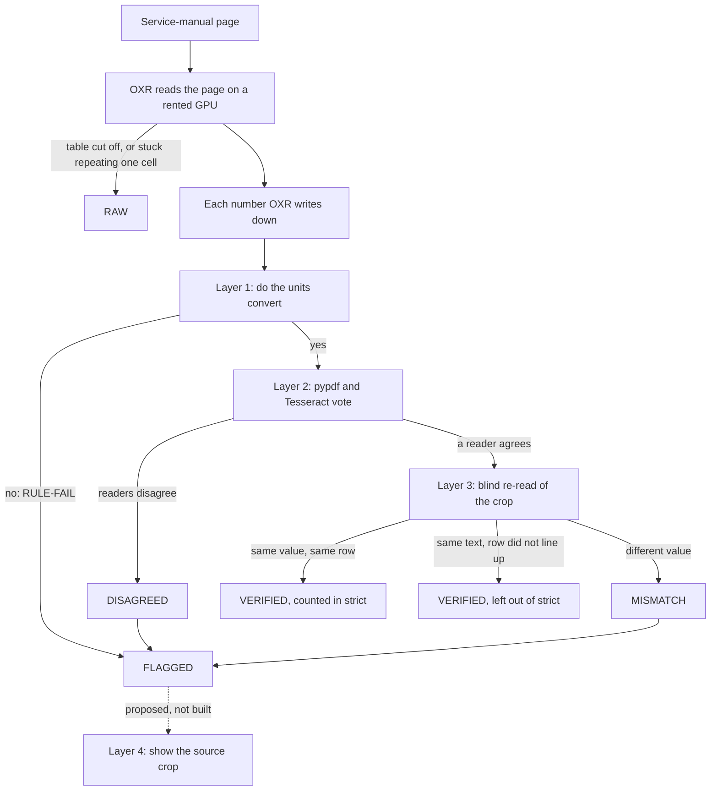

# Pulling specs out of the service manuals

The chat mechanic is only supposed to repeat a torque, a clearance, or a spec that is actually printed in the service manual. This note is the record of how we pulled those numbers out of the 2JZ-GE repair manual, how we checked them, and what is still unsafe to trust.

An interactive picture of the same pipeline, drawn from the earlier public-page test, is in [PR #165](https://github.com/zeketx/sidekick-mechanic/pull/165). This page is the later write-up, including the full manual. The raw count files stay on the bot's machine. They are not in the repo.

## TL;DR

Plain text from the PDF scrambles tables, and one OCR pass misreads sizes. A wrong torque can snap a bolt. We ran the pages through OXR on a rented GPU, then checked every number three ways: do the units convert, does another reader see the same digits, and does a vision model read the same crop the same way.

On the 193-page spec sample, the share we would trust went from **72.1%** to **94.2%** to **94.3%** as the checker got smarter. On the other 1,809 pages of the repair manual it is **64.9%** (it was 61.8% before the last checker fix), or **76.6%** if you set aside two pages where OXR's table was cut off. The back of the book is about **89%**. The diagnostics section is about **54%**. The whole full-manual pass cost **about $1.81** and OXR took **about 0.95 seconds a page** on an A40.

Those checked numbers are not in the search index yet. Until they are, the app still answers from the old plain-text pages.

## Why we needed it

Sidekick answers from the factory manuals: the Toyota LJ78 chassis book, the 2JZ-GE engine repair manual, and the ECU docs. The reply cites a page, and a spec guard then throws out any number that is not in the text we stored for that page. That guard is only as good as the text. If the stored line is the wrong row, or a misread, the guard will happily keep a bad torque.

[Issue #163](https://github.com/zeketx/sidekick-mechanic/issues/163) tested this on public-domain pages before anyone touched the copyrighted manuals. The current ingester (`pypdf`, the same call `ingest.py` uses) got **5 of 35** spot-checked table values. OXR got **33 of 35**. It still misread fastener fractions, and a second run misread them differently (5/16 came back as 1/6). Tesseract, for reference, got 12 of 35. OXR was worth using. Its raw output was not worth trusting.

## What we built

OXR (SoMark OXR-1.0) reads each page into text, tables, and pictures. It ran self-hosted on vLLM 0.25.1, on a Runpod GPU, because the manual pages should not go to someone else's document API. Every number it wrote down then went through the checks from the #163 design.

1. **Unit rules.** Torque, length, and temperature conversions have to agree (N·m against kgf·cm against ft·lbf, mm against inches, °C against °F). A failure is flagged. The rule never "fixes" the number.
2. **A vote.** OXR's digits have to match another reader on that page: the PDF text layer (`pypdf`) or Tesseract. On a scan with no text layer, only Tesseract can vote.
3. **A blind re-read.** Gemini flash-lite (`gemini-3.5-flash-lite` on OpenRouter) transcribes the cropped table without seeing OXR's answer. The number has to show up as the same value. Blind mode is the one we kept. A confirm-mode trial, where the model was shown OXR's cells and asked to judge them, let bad row-shifts through.
4. **Show the crop.** When the checks are still unsure, the owner should see the snippet of the page, not a bare number. This layer is proposed. It is not built.

What the words mean:

| State | Meaning |
| --- | --- |
| **VERIFIED** | Passed the unit rule, at least one other reader, and the blind re-read. This is the only state that should be served as a fact. |
| **FLAGGED** | At least one check failed. The reason is attached: a unit rule (`RULE-FAIL`), readers that disagree (`DISAGREED`), a vision reading that differs (`MISMATCH`), both, or a crop the vision model could not read (`UNREADABLE`). |
| **RAW** | OXR's table was cut off or stuck in a loop. These values are never trusted and can never become VERIFIED. |
| **strict** | The tighter VERIFIED count. A value can still be VERIFIED when the vision model saw the same text somewhere in the table but the rows did not line up. Strict leaves those out, because we confirmed the digits and not which row they belong to. |

`DISAGREED` and `MISMATCH` are reasons on the way to `FLAGGED`. The stored result for a value is `VERIFIED`, `FLAGGED`, or `RAW`.

## What we got

Two runs, both on the owner's manuals, neither committed (the PDFs stay out of git).

### The spec sample: 72.1% → 94.2% → 94.3%

193 pages: SS-1 through SS-50 and EM-1 through EM-100 of RM1054U (150 pages, the torque and clearance sections), plus all 43 pages of the IS300 engine wiring book EWD451U. The wiring book produced **0 values**. OXR returns those diagrams as pictures.

The percentages below are the share of extracted numbers marked VERIFIED. The same OXR output was re-scored as the checker improved. No second GPU pass.

| Checker | Numbers scored | VERIFIED | Strict |
| --- | --- | --- | --- |
| v1 | 3,379 | 2,437 (**72.1%**) | — |
| v2 | 2,910 | 2,742 (**94.2%**) | 91.6% |
| v3 | 2,984 | 2,813 (**94.3%**) | 91.7% |

v2 looks like a huge jump mostly because v1 was counting a broken page. On EM-9 (PDF p749) OXR looped and wrote the same shim cell, `2.500 (0.0008)`, about 480 times. All of those were flagged or, after v2, dropped. v2 deleted 477 duplicate cells, left 3 as RAW, and scored the real shim-number table on that page (25 values, all verified). The big shim-selection grid on the same page is a picture. It was never extracted, so it is not in these percentages.

Nothing that was VERIFIED in v1 lost that mark in v2 or v3.

### The rest of the repair manual: 61.8% → 64.9%

The next run was the other **1,809 pages** of RM1054U. Together with the 150-page SS/EM slice, that is the whole 1,959-page manual. Checker v2.1 scored it, then v3 scored the same pages again. OXR itself was not re-run.

| | v2.1 | v3 |
| --- | --- | --- |
| Numbers scored | 5,595 | 6,403 |
| VERIFIED | 3,455 (**61.8%**) | 4,156 (**64.9%**) |
| Strict | 3,315 (59.2%) | 4,032 (63.0%) |
| VERIFIED, without the 2 RAW pages | 74.9% | **76.6%** (strict 74.3%) |
| FLAGGED | 1,160 | 1,267 |
| RAW | 980 | 980 |
| Unit-rule fails | 72 | 16 |

The percentage only moved a few points because v3 also started scoring 1,002 rows the old header parser had swallowed (685 of them verified) and stopped scoring 194 page references such as `See page SA-88`. On the 5,401 numbers present in both versions, **165 flags cleared and zero verified numbers flipped back to flagged.**

Where the v3 numbers sit:

| Slice | Numbers | VERIFIED | Strict |
| --- | --- | --- | --- |
| All 1,809 pages | 6,403 | 4,156 (64.9%) | 4,032 (63.0%) |
| Without DI PDF p0210 and p0528 (980 RAW values) | 5,423 | 76.6% | 74.3% |
| Diagnostics block, PDF pp. 192–740 | 4,168 | 2,267 (**54.4%**) | 52.7% |
| Front of the book, before p142 | 460 | 315 (68.5%) | 57.8% |
| Back of the book, after p840 | 1,775 | 1,574 (**88.7%**) | 88.5% |

The back of the manual (after PDF p840) is in good shape. Diagnostics (DI) is the weak part: scanned fault-code matrices, and long code tables where the readers do not line up.

Of the 1,267 still flagged on this run:

| Why it was flagged | Values |
| --- | --- |
| Vision read a different value (`MISMATCH` only) | 496 |
| The other readers disagreed (`DISAGREED` only) | 475 |
| Both | 269 |
| Unit rule failed, and vision also mismatched | 3 |
| Unit rule failed on its own | 13 |
| Vision model could not read the cell | 11 |

331 of those flags are on scanned pages with no text layer. 322 of them are on the 12 DTC monitor matrices (DI PDF pp. 210–215 and 528–533). Two of those twelve pages are the RAW ones, separate from this flag count.

Four spot checks of 40 verified numbers each all matched the page. Most of those were found in the PDF text layer. A handful on picture pages were checked by eye against the render. The breakdown is in [Technical details](#technical-details). These are samples, not a full audit.

### What each checker fix did

**v1 → v2** (193-page sample, same OXR output, one extra vision call at $0.0012):

- A cell that spans rows is scored once, where it starts. In v1 the spanning cell got mixed into every row and broke the match.
- Row names are matched as words. Long names wrap, and a name like "No. 1" was hiding its digit inside the number check.
- Stacked cells (several specs in one printed cell) are checked one line at a time if the whole row fails.
- Small-integer lookup grids (the bearing-selection charts) count as a match when a reader line has that exact digit sequence.
- Torque tables with two unit groups are both checked. v1 only checked the last group, and missed a real rounding inconsistency on SS-2 because of that.
- The EM-9 loop is collapsed. Repeats of 8 or more identical cells are removed. A cut-off table can never be VERIFIED.
- The vision check can confirm a value from another column of the same row, or (this is the "not strict" case) from the same text elsewhere in the table when the rows do not line up.

**v2 → v2.1** (full-manual copy only): the loop detector was calling real DTC tables a loop because they repeat "OK" eight or more times. A table is a loop only when its markup is cut off (no closing `</table>`) or a run of 20 or more identical cells. A cut-off table is always RAW.

**v2.1 → v3** (both sets, no GPU):

- DTC codes are codes. `P0030,50` and `C0279/12` are not broken numbers. A real number with a unit in the same cell is still checked. On the full run this cleared the 58 DTC-code false alarms inside the 72 rule fails. Sixteen rule fails remain.
- Header detection no longer swallows a whole diagnostics table. That recovery is the 1,002 newly scored values.
- A cell whose only digits are a page reference is not a spec. That removal is the 194 dropped values, including the SS-38 "See page SA-88" false alarm.
- Glued lines (`P0301 (DI-164)`) are checked one printed line at a time.
- The vision step reuses the cached read when it already covers the table, decodes escaped characters, and lines a row up on a single unique cell match.

### Typos that are really printed in the manual

The unit rule caught these, and the PDF text layer shows the same pairs. They are printed in the manual. They stay flagged. They are not specs to use.

From the SS/EM sample:

| Where | Printed | What the conversion expects |
| --- | --- | --- |
| SS-9, PDF p150 | 49 N·m / 500 kgf·cm / **30** ft·lbf | about 36 ft·lbf |
| SS-9, PDF p150 | 119 N·m / **1,120** kgf·cm | about 1,213 kgf·cm |
| SS-9, PDF p150 | 6.0 / 60 / 53, no unit on the last number | 53 is in.·lbf, and the unit is missing |
| SS-27, PDF p168 | 9.8 N·m / **10** kgf·cm | about 100 kgf·cm |
| SS-27, PDF p168 | 25 N·m / **25.5** kgf·cm | about 255 kgf·cm |
| SS-30, PDF p171 | 6.4 / 65 / 56, no in.·lbf unit on that row | unit missing |
| SS-19, PDF p160 | 29.0 mm (**1.412** in.) | about 1.142 in. |
| SS-2, PDF p143 | 5 N·m / 55 kgf·cm / **48** in.·lbf | 5 N·m is about 44 in.·lbf; 48 matches 55 kgf·cm (about 5.4 N·m). A rounding inconsistency. v1 never checked this column group. |

From the rest of the manual:

| Where | Printed | What the conversion expects |
| --- | --- | --- |
| DI-355, PDF p546 | ATF temperature 110 °C (176 °F) | 110 °C is 230 °F, and 176 °F is 80 °C |
| RS-23, PDF p1347 | Width 185 mm (7.87 in.) | 185 mm is 7.28 in., and 7.87 in. is 200 mm |
| DI-279, PDF p470 | Engine coolant temperature, maximum 0°C (0°F) | 0 °C is 32 °F. Treated as a likely typo. |
| ST-7, PDF p1003 | Minimum diameter 29.0 mm (1.412 in.) | same pair as SS-19 |
| MT-8, PDF p1057 | 9.8 N·m (10 kgf·cm, 7 ft·lbf) | same pair as SS-27 |

One OXR invention, separate from the printed typos: on EM-91 (PDF p831) it added "0.06 mm (0.0001 in)" next to the real "0.06 mm (0.0024 in.)". The unit rule and the vote both caught it.

### Cost and speed

The full-manual pass, as added up after Runpod billing posted:

| Piece | Cost |
| --- | --- |
| Runpod A40, about 48 minutes, billed | $0.46 ($0.4617) |
| OpenRouter, the full-run vision check, 1,343 calls | $0.95 ($0.9543) |
| OpenRouter, the v3 re-check, 338 new calls, the rest from cache | $0.40 ($0.3983) |
| **Total** | **$1.81** |

OXR's main pass on that A40 was 1,724 seconds, **0.95 s/page**, at concurrency 8. Four pages timed out around 245 seconds and succeeded on a retry. The pod is terminated.

The earlier 193-page GPU run is not inside that $1.81. It was a smaller card (a 24 GB slice), about 1.73 s/page, about $0.43 for that pass. Details are in [Technical details](#technical-details).

## What's still missing

- **Scanned diagnostics matrices.** Twelve DTC monitor pages are pictures with no text layer, so the vote is Tesseract alone. 322 flags sit there. On two of them, DI PDF p0210 and p0528, OXR's table was cut off and 980 values are RAW.
- **Wiring diagrams.** OXR returns the drawing as a picture and we score pictures as nothing. The 43-page EWD451U run extracted 0 values. Inside RM1054U, 78 pages contain a wiring diagram (none of those pages is diagram-only, so the words on the page were still checked) and 47 of them had nothing extracted from the drawing.
- **The EM-9 shim-selection grid.** Image only: about 41 shim-thickness columns by about 50 clearance rows, counted off the page image, so those counts are approximate. No text layer, Tesseract garbles the digits on the grid lines, and OXR did not transcribe it. The grid is not in the scored numbers. The small shim-number table on the same page is separate, and those 25 values are verified.
- **Dense tables where the readers disagree about layout.** Bearing-selection grids, bolt tables with a class cell spanning rows, sensor-resistance stacks, and DI label matrices. Hundreds of `DISAGREED` and `MISMATCH` flags are this, not a known wrong digit. They stay flagged for a look.
- **Temperature differences.** Eleven values such as `3 °C (5.4 °F)` are a change in temperature, printed as a difference. The rule treats them as thermometer readings (3 °C would be about 37 °F) and flags them. The rule was left strict on purpose. They are false alarms.
- **Layer 4 is not built.** A flagged number still has nowhere to show the crop.
- **LJ78 chassis and the ECU manual have not been run.** `lj78-wiring` is blocked: the file is image-only and AES-encrypted, and it does not name LJ78 ([MANUALS.md](MANUALS.md), [ewd-ingest-unblock.md](design/ewd-ingest-unblock.md)). We need a readable chassis wiring manual before that run means anything. The ECU book depends on which computer is in the truck. That stays unknown until there is a photo of the `89661-` label ([ECU.md](vehicle/ECU.md)).
- **Nothing is in the repo or the search index.** Outputs live on the bot's box under `/workspace/oxr-2jz/`. The pod is gone. Today's ingest is still one plain-text chunk per page, and the [spec guard](design/spec-guard.md) checks answers against that text.

## What to do next

In this order:

1. **Put the checked values in the search index, with the state attached.** Only `VERIFIED` is served as a fact. `FLAGGED` is shown with the source crop (that is layer 4). `RAW` stays out. The spec guard keeps having the last word.
2. **A different approach for scanned matrices and wiring.** OXR's table reader is the wrong tool for a picture of a fault-code grid or a connector drawing. Use a vision model aimed at pins, connectors, and matrix cells, and keep those results in their own check. The earlier wiring spike already points at citing the page image when the text is not trustworthy ([wiring-diagram-spike.md](design/wiring-diagram-spike.md)).
3. **Then the LJ78 manual and the ECU manual.** After there is a readable LJ78 wiring manual, and a photo of the ECU's `89661-` number so we know which book to open.

## Technical details

Numbers in this note come from the comments on [#163](https://github.com/zeketx/sidekick-mechanic/issues/163) and from the v3 count files on the bot's box (`full/out/v3/counts.json`, `full/out/v3/compare_v2_v3.json`, and the 193-page `compare_v2_v3.json`). Those JSON files are not committed. Where a comment rounds and the count file has pennies or a tenth of a percent, both are shown.

### How a value moves

Layer 2 agrees when **at least one** independent reader matches OXR. On the first 193-page scoring that was 2,624 agreed and 755 disagreed, out of 3,379. A tighter cut that required **both** readers to match was 2,433 agreed and 946 disagreed. That "both readers" cut is not the **strict** column in the tables above. Strict, in v2 and v3, is only about the vision step: it drops VERIFIED values whose match was "the text appears in this table, and the rows did not line up."

Vision unreadable is a flag, not a pass. On v1 that was 529 values, mostly the EM-9 loop and spanned tables. On v3 of the full run it is 11.

OXR often rewrites `in.·lbf` as `in lbf` or `in ibf`. When the number was right, that was treated as punctuation and not flagged.

### The 193-page run, v1

OXR returned 85 table blocks, all of them in RM1054U, plus 1,263 text blocks, 351 pictures, and 316 titles. EWD451U was 39 pictures, 3 captions, and 2 titles.

3,379 numbers on 98 pages were checked: 3,217 table cells and 162 inline specs. 73 tables had numeric cells.

| Layer | v1 result |
| --- | --- |
| Unit rules | 3,358 passed, 21 failed |
| Vote | 2,624 agreed, 755 disagreed |
| Blind vision | 2,700 confirmed, 150 mismatch, 529 unreadable |
| Final | 2,437 VERIFIED (72.1%), 942 FLAGGED |

480 of the flags were the EM-9 loop. Setting that page aside: 2,874 numbers, 2,437 VERIFIED (84.8%), 437 flagged. By section on v1: SS 2,152 verified and 326 flagged, EM 285 verified and 616 flagged.

The machine was a Secure RTX PRO 6000 MIG slice (24 GB, $0.69/hr), concurrency 4. 193 pages in 333.7 seconds of wall clock, **1.73 s/page**, including a 243-second failed EM-9 request (OXR error 1137). With the 87-second retry, about **2.2 s/page**. Median request time: wiring 0.31 s, EM 5.7 s, SS 8.0 s. Tesseract on the same machine, 12 processes, finished the 193 pages in 121 seconds.

Cost of that run: about **$0.22** of GPU time (estimate from the clock, not a posted bill; about 0.33 GPU-hours) and **$0.2085** of OpenRouter (218 calls, 0 errors). About **$0.43** together. The later checker-only calls are extra: **$0.0012** for v2 (1 call) and **$0.0371** for the v3 re-score of this set (19 calls). The $0.0371 is included in the full-manual $1.81 below, because that is how the v3 bill was totaled. The $0.22, the $0.2085, and the $0.0012 are not.

### Checker v2 on that same output

| | v1 | v2 |
| --- | --- | --- |
| Scored | 3,379 | 2,910 |
| VERIFIED | 2,437 (72.1%) | 2,742 (94.2%); strict 2,665 (91.6%) |
| FLAGGED | 942 | 165 |
| RAW | — | 3 |
| Unit-rule fails | 21 | 24 |
| Disagreed | 755 | 81 |
| Vision mismatch | 150 | 51 |
| Unreadable / skipped | 529 / 0 | 22 / 3 |

The 24 v2 rule fails include the SS/EM printed typos in the table above, the EM-91 misread, the new SS-2 catch, and the SS-38 "See page SA-88" false alarm. v3 drops that false alarm (it is the one reference removed on this set).

v2 also added 8 grid row-label cells on EM-85 and removed the 477 duplicate EM-9 cells. Newly verified: 305. All 2,437 v1 verified values stayed verified.

The v2 write-up splits the 165 flags like this. Two of the 22 unreadable cells also disagreed, and 2 of the 24 rule fails also carry another reason, so the rows are the write-up's buckets, with that overlap. The 3 RAW leftovers sit outside the 165. v3's flag mix on this set was not broken out the same way. v3 has 168 flagged and the same 3 RAW.

| Why | Values |
| --- | --- |
| Disagreed only | 70 |
| Vision mismatch only | 44 |
| Unreadable | 22 |
| Unit-rule fail | 24 |
| Disagreed and mismatch | 5 |

v3 on this set: 2,813 / 2,984 verified (94.3%, strict 91.7%). One reference removed, 75 values added (66 verified, 9 flagged), 5 flags cleared, 0 regressions. Spot check on the 40 newly verified v2 values: 36 matched in `pdftotext -layout`, and the other 4 are EM-9 shim-table cells with no text layer, confirmed by eye (shims 1, 3, 14, and 16).

The other three samples of 40: v1 verified values, all 40 found in the PDF text layer; the full-run v2.1 verified values, 37 in `pdftotext` and 3 on raster pages confirmed from the 300 dpi render; v3 newly verified values across both sets, all 40 in `pdftotext -layout`.

### Full run, v2.1, before the v3 re-score

1,809 pages: diagnostics block 549, front 141, back 1,119. Every page was sent. 1,098 pages had nothing to check (procedure text and figures). 94 pages were picture or title only.

Section page counts from the headers on those pages: DI 469, BO 238, BE 230, SF 136, PP 86, AC 83, RS 79, SA 65, IN 60, SR 59, BR 56, MT 47, AT 41, CO 36, ST 19, CH 17, CL 17, EC 14, IG 14, LU 13, PR 12, EM 9, MA 5, SS 2, GL 2.

v2.1 verified rate by section, on the values it scored (the DI row is 1,611 / 3,381):

| Section | VERIFIED | Section | VERIFIED |
| --- | --- | --- | --- |
| DI | 47.6% | AT | 68.8% |
| PP | 69.2% | BR | 98.1% |
| BE | 83.9% | SA | 95.9% |
| BO | 90.2% | SR | 86.2% |
| SF | 82.4% | IN | 49.3% |
| AC | 91.2% | | |
| MT | 99.1% | | |

The v2.1 write-up called everything else at least 78%. v3 re-scored these pages, so the table in the next section is the current one.

v2.1 flag reasons: mismatch only 429, disagreed only 375, both 275, unit-rule 72, unreadable 9. Of the 72 rule fails, 58 were DTC codes read as broken thousands-separators, 10 were temperature differences, and 4 were the printed typos (DI-355, RS-23, ST-7, MT-8). 364 flags were on raster pages, 356 of them on the 12 DTC matrix pages.

Four OXR timeouts at about 245 seconds, DI PDF p0210, p0528, p0530, and p0533. All four succeeded on retry. p0210 and p0528 came back truncated and are the 980 RAW values.

GPU: one Secure A40 in EU-SE-1, $0.59/hr, concurrency 8, Tesseract with 4 processes. Setup about 10 minutes. OXR main pass 1,724 s (0.95 s/page), 1,865 s including retries. Tesseract 1,912 s. Pod lifetime about 48 minutes. The vision check was about 1,343 calls.

Spend before the v3 re-score: about $0.47 of GPU (estimate at the time) and $0.9543 of OpenRouter, about $1.42. Billing later posted the GPU at $0.4617.

### Full run, v3, current counts

Compare file totals: 194 references dropped (149 had been VERIFIED, 45 flagged), 1,002 values added (685 verified, 317 flagged), 165 flags cleared on values both versions scored, 0 regressions, 850 newly verified in all (685 plus 165). On the 5,401 shared values, verified went from 61.2% to 64.3%.

v3 by section on the 1,809-page run only (the count file, not the v2.1 table, and not the SS/EM pilot). The SS and EM rows here are the few pages of those sections that fell outside the pilot range:

| Section | Values | VERIFIED | % | Strict % | Flagged | RAW |
| --- | --- | --- | --- | --- | --- | --- |
| AC | 141 | 128 | 90.8 | 90.8 | 13 | 0 |
| AT | 105 | 75 | 71.4 | 71.4 | 30 | 0 |
| BE | 541 | 455 | 84.1 | 83.9 | 86 | 0 |
| BO | 248 | 223 | 89.9 | 89.9 | 25 | 0 |
| BR | 87 | 85 | 97.7 | 97.7 | 2 | 0 |
| CH | 25 | 24 | 96.0 | 96.0 | 1 | 0 |
| CL | 18 | 18 | 100.0 | 100.0 | 0 | 0 |
| CO | 45 | 38 | 84.4 | 84.4 | 7 | 0 |
| DI | 4,110 | 2,237 | 54.4 | 52.7 | 893 | 980 |
| EC | 6 | 6 | 100.0 | 100.0 | 0 | 0 |
| EM | 10 | 10 | 100.0 | 100.0 | 0 | 0 |
| GL | 6 | 5 | 83.3 | 83.3 | 1 | 0 |
| IG | 22 | 22 | 100.0 | 100.0 | 0 | 0 |
| IN | 69 | 46 | 66.7 | 66.7 | 23 | 0 |
| LU | 25 | 20 | 80.0 | 80.0 | 5 | 0 |
| MA | 4 | 4 | 100.0 | 100.0 | 0 | 0 |
| MT | 117 | 115 | 98.3 | 98.3 | 2 | 0 |
| PP | 407 | 277 | 68.1 | 56.0 | 130 | 0 |
| PR | 20 | 20 | 100.0 | 90.0 | 0 | 0 |
| RS | 32 | 27 | 84.4 | 84.4 | 5 | 0 |
| SA | 99 | 94 | 94.9 | 93.9 | 5 | 0 |
| SF | 154 | 132 | 85.7 | 85.7 | 22 | 0 |
| SR | 82 | 69 | 84.1 | 84.1 | 13 | 0 |
| SS | 3 | 3 | 100.0 | 100.0 | 0 | 0 |
| ST | 27 | 23 | 85.2 | 85.2 | 4 | 0 |

The DI **section** (4,110 values) and the DI **page block** (4,168 values, PDF pp. 192–740) are different cuts. Both come out to 54.4% verified. The block includes a few pages whose header is another section. The 980 RAW values are in both cuts.

The 16 remaining rule fails are 11 temperature-difference false alarms on DI PDF pp. 285, 298, 423, and 444, plus the five printed values in the typo table (DI-279, DI-355, ST-7, MT-8, RS-23). The count file's checker message for the 29.0 mm pair says "expected ≈1.14"; the SS-19 note says "≈1.142". Same printed pair.

PP's strict rate (56.0%) is well under its verified rate (68.1%). A lot of those verified values are the "right text, row not lined up" kind. The front-of-book strict rate (57.8% against 68.5% verified) is the same gap.

### Bills, added up

| Piece | Calls | Amount | Inside the $1.81 |
| --- | --- | --- | --- |
| 193-page Runpod, estimate | — | about $0.22 | no |
| 193-page OpenRouter, first vision pass | 218 | $0.2085 | no |
| v2, one new vision call | 1 | $0.0012 | no |
| Full-run Runpod A40, billed | — | $0.4617 | yes |
| Full-run OpenRouter | 1,343 | $0.9543 | yes |
| v3 OpenRouter, full run | 319 | $0.3612 | yes |
| v3 OpenRouter, 193-page re-score | 19 | $0.0371 | yes |

v3's two OpenRouter lines sum to $0.3983 across 338 calls, 0 errors. $0.4617 + $0.9543 + $0.3983 = $1.81.

The public-page layer-3 test that picked the vision model, before any of this, was a separate **$0.88**. A 175-cell pilot of the same model was $0.009 and scored 175/175. That spend is not in the table.

### Where the files are

On the bot's box, not in git:

- Full run: `/workspace/oxr-2jz/full/` with OXR output in `oxr/`, Tesseract in `tess2/`, and v3 results in `out/v3/` (`l3_cells.json`, `counts.json`, `compare_v2_v3.json`). Page lists (wiring, picture-only, empty) are in `out/v2/page_lists.json`.
- 193-page v3 results: `/workspace/oxr-2jz/out/v3/`.
- Running summary: `/workspace/oxr-2jz/summary.md`.

### License

OXR's code and weights use the OXR Open Source License: Apache-2.0 plus extra terms. Commercial use without a separate license is only while funding and annual revenue are each at or below $2,000,000. An online service that uses it has to name "SoMark OXR" in the UI or the public docs. It is fine for this project. It is worth a look before the parser sits on the hosted backend. Source and the full terms are in [#163](https://github.com/zeketx/sidekick-mechanic/issues/163).
